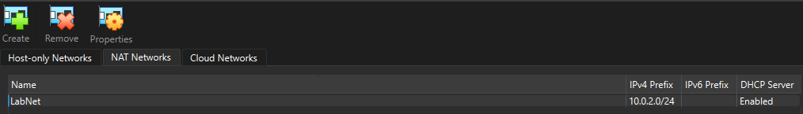
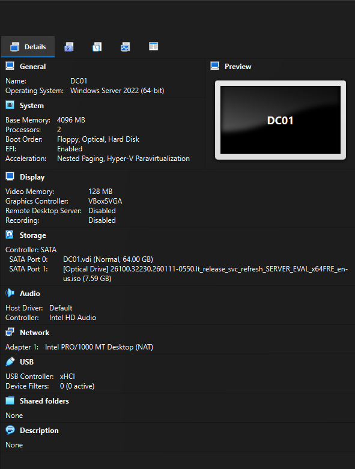
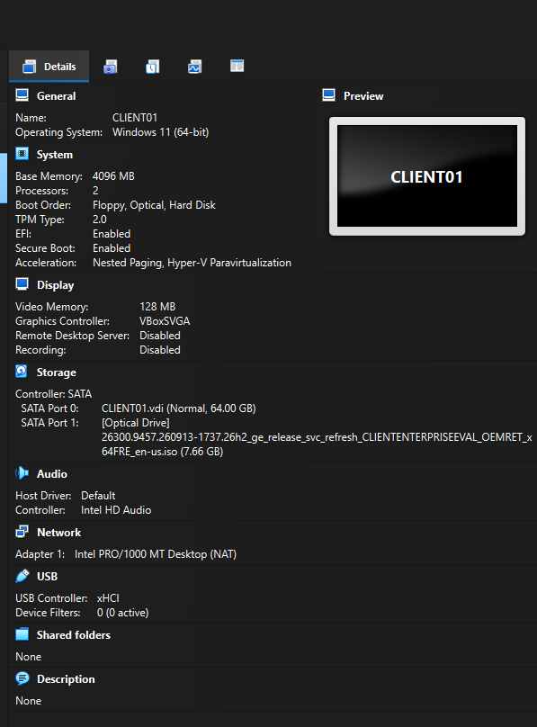

# 01 - VirtualBox-ympäristö

Tein 4.11.2026 virtuaaliverkon ja kaksi virtuaalikonetta.

## Virtuaaliverkko: LabNet

* Tyyppi: NAT Network, verkko 10.0.2.0/24, gateway 10.0.2.1, DHCP päällä
* Miksi NAT Network eikä pelkkä NAT: pelkässä NAT:ssa jokainen VM on omassa kuplassaan
eivätkä ne näe toisiaan. NAT Networkissa ne ovat samassa verkossa ja pääsevät silti nettiin.

## DC01 (palvelin)

* Windows Server 2025 Evaluation (Desktop Experience)
* 4 GB RAM, 1 CPU (alun perin 2), EFI, 64 GB levy
* Verkko: Adapter 1 → NAT Network (LabNet)
* Automaattinen asennus ohitettu, jotta asennan Windowsin itse

## CLIENT01 (työasema)

* Windows 11 Enterprise Evaluation
* 4 GB RAM, 1 CPU (alun perin 2). EFI, Secure Boot, TPM 2.0, 64 GB levy
* Verkko: Adapter 1 → NAT Network (LabNet)
* Huom: VirtualBox 7.2:ssa kohta on nimeltään "Proceed with Unattended Installation".
Jätin sen valitsematta.
* Unohdin ensin vaihtaa verkon NAT → NAT Network. Huomasin sen tarkistuksessa ja korjasin.
* Vähensin prosessorit kahdesta yhteen jo etukäteen, jotta sama käynnistysongelma kuin DC01:llä ei toistuisi.

> **Päivitys:** Nykyään molemmissa koneissa on 3 GB RAM ja 2 CPU. Prosessorit palasivat kahteen,
> kun kytkin Windowsin hypervisorin pois omalta koneeltani (ks. [troubleshooting](troubleshooting.md)),
> ja muistin laskin 3 GB:hen muistipulan takia (ks. [04 - CLIENT01 domainiin](04-client-domain-join.md)).

