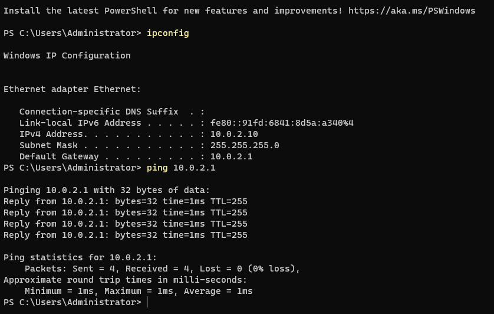
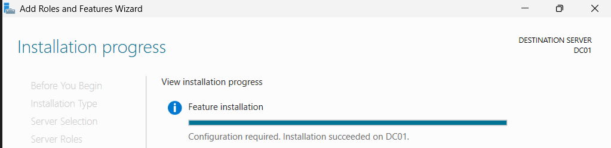
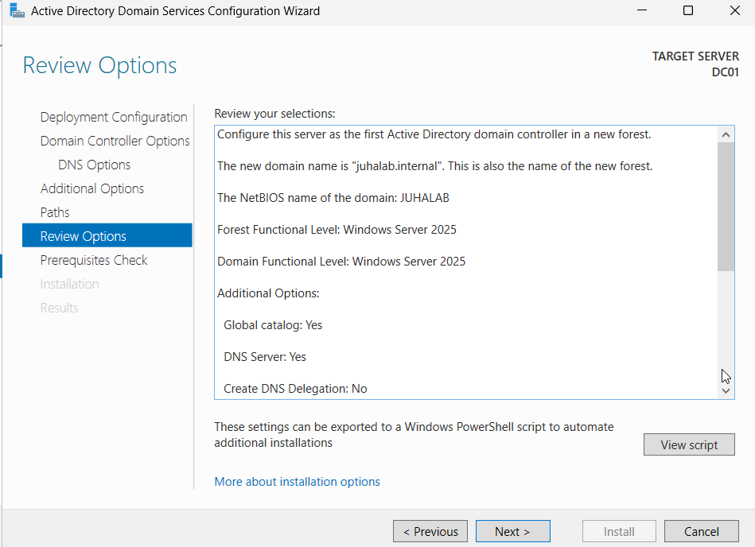
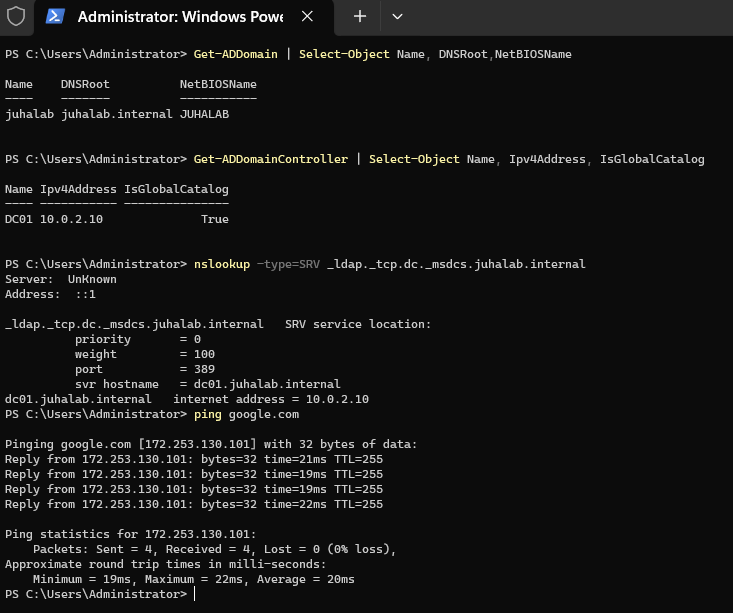

# 03 - Active Directory (DC01)

Tein 5.11.2026.

## Mitä tein

1. **Testasin serverin netin:** `ipconfig`, `ping 10.0.2.1` ja `ping google.com` menivät läpi.

   

2. **Asensin AD DS -roolin** (Server Manager → Manage → Add Roles and Features).
   Rooli tekee palvelimesta valmiin domain controlleriksi, mutta ei vielä luo domainia.

   

3. **Promotoin DC01:n domain controlleriksi:**
   - Uusi forest, domain `juhalab.internal`, NetBIOS-nimi `JUHALAB`
   - DNS-palvelin ja Global Catalog asentuivat samalla
   - DSRM-salasana on varasalasana palvelimen korjaustilaan
   - Keltaiset varoitukset (esim. DNS delegation) ovat labrassa normaaleja

   

4. Uudelleenkäynnistyksen jälkeen kirjauduin domain-tunnuksella `JUHALAB\Administrator`.

## Miten tarkistin, että domain toimii

| Komento | Mitä se kertoo | Tulos |
|---|---|---|
| `Get-ADDomain` | Domain on olemassa | juhalab.internal / JUHALAB |
| `Get-ADDomainController` | DC01 on domain controller | DC01, 10.0.2.10, Global Catalog: True |
| `nslookup -type=SRV _ldap._tcp.dc._msdcs.juhalab.internal` | Domain controller löytyy DNS:n kautta | dc01.juhalab.internal |
| `ping google.com` | Netti toimii yhä | OK |

## Miksi DNS on tärkeä AD:ssa

DNS ei pelkästään muuta nimiä IP-osoitteiksi. AD:ssa se toimii myös "puhelinluettelona",
josta koneet etsivät domain controllerin (SRV-tietueet). Siksi clientin DNS:n pitää osoittaa
DC:hen, muuten domainiin liittyminen ei onnistu.

## Pikkujuttuja

- Pystyviiva `|` suomalaisella näppäimistöllä: AltGr + < (Z:n vieressä oleva näppäin).
- nslookup näyttää "Server: UnKnown". Se on normaalia, koska DNS:ssä ei ole vielä
  käänteistä hakua (reverse lookup zone). Haku toimii silti.

## Seuraavaksi

- Asennan Windows 11:n CLIENT01:een
- Asetan clientin DNS:n osoittamaan DC01:een (10.0.2.10)
- Liitän CLIENT01:n domainiin
