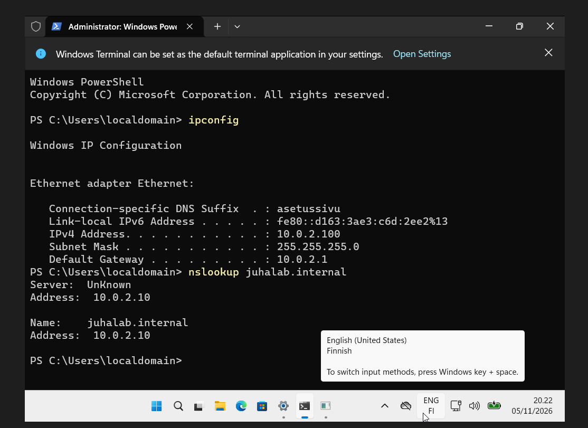
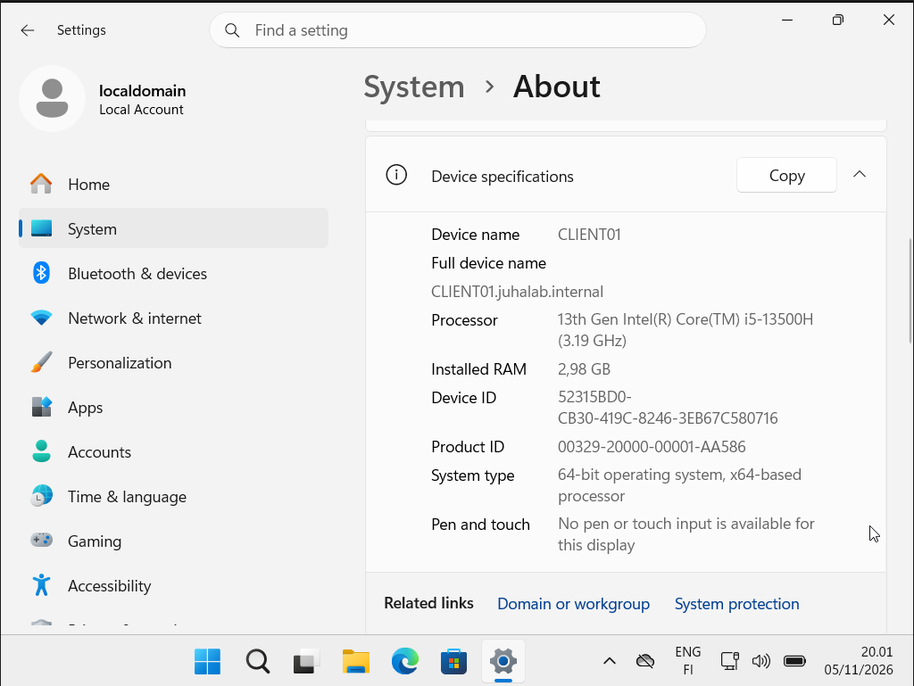

# 04 - CLIENT01 domainiin

Tein 5.11.2026.

## Windows 11:n asennus

- Windows 11 Enterprise Evaluation, kieli English (US), näppäimistö Finnish
- Asennuksen alussa Windows ilmoitti, että prosessoreita pitää olla vähintään kaksi.
  Kahdella prosessorilla tuli taas musta ruutu, joten jouduin kytkemään Windowsin hypervisorin
  pois omalta koneeltani (katso troubleshooting.md).
- Aloitusruuduissa valitsin **Sign-in options → Domain join instead**, jotta koneelle tuli
  paikallinen tili eikä Microsoft-tiliä. Domainiin liitytään myöhemmin erikseen.

## Muistipula

Kun molemmat VM:t olivat päällä 4 Gt:n muistilla, omalta koneeltani loppui muisti
(vapaata 0,4 Gt) ja CLIENT01 jumittui. Laskin molempien VM:ien muistin 3 Gt:iin.
Windows 11 tarkistaa 4 Gt:n vaatimuksen vain asennuksessa, joten 3 Gt riittää labrassa.

DC01 asensi sammutuksen yhteydessä päivityksiä, ja siihen meni hetki. En sammuttanut sitä väkisin,
koska kesken jäänyt päivitys voi rikkoa Windowsin.

## DNS osoittamaan DC01:een

Settings → Network & internet → Ethernet → DNS server assignment → Manual → IPv4 → `10.0.2.10`

Testit:
- `ipconfig /all`: IP DHCP:ltä (väliltä .100–.200), DNS 10.0.2.10
- `nslookup juhalab.internal` → 10.0.2.10

Tämä on tärkein kohta: jos clientin DNS osoittaa muualle (esim. reitittimeen tai Googleen),
se ei löydä domainia, eikä domainiin liittyminen onnistu.

## Domainiin liittyminen

Settings → System → About → Domain or workgroup → Change...
- Computer name: CLIENT01
- Member of → Domain: `juhalab.internal`
- Tunnukset: `JUHALAB\Administrator`
- Uudelleenkäynnistys

Uudelleenkäynnistyksen jälkeen kirjauduin **Other user** -kohdasta tunnuksella `JUHALAB\Administrator`.
Eli sama tunnus toimii nyt sekä serverillä että clientilla. Tämä on koko AD:n idea.

Sekoilin hetken, koska vaihdoin ensin koneen nimen ja yritin liittää domainiin ennen
uudelleenkäynnistystä. Kannattaa tehdä nimi ja domain samalla kertaa samassa ikkunassa,
tai käynnistää kone uudelleen välissä.

## Seuraavaksi

- Luon domainiin omia käyttäjiä ja ryhmiä (OU-rakenne)
- Kokeilen ryhmäkäytäntöjä (GPO)
- PowerShell-skriptejä scripts-kansioon
