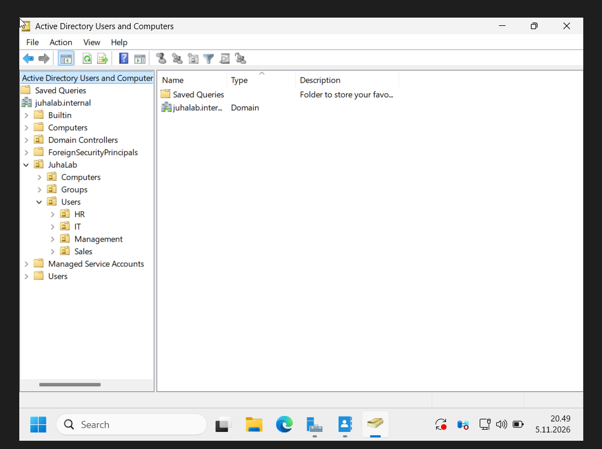
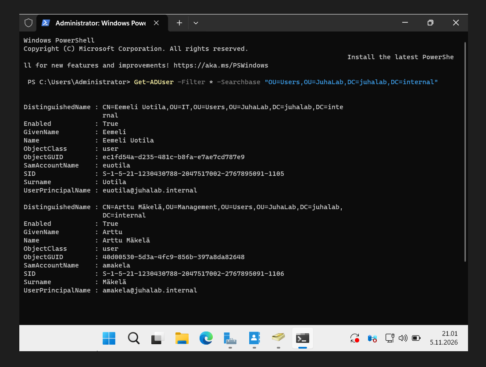

# 05 - OU-rakenne ja käyttäjät

Tein 5.11.2026.

## OU-rakenne

OU (Organizational Unit) on AD:n kansio. Sillä järjestetään käyttäjät ja koneet, ja ryhmäkäytännöt (GPO)
kohdistetaan OU:ihin. AD:n valmiit Users- ja Computers-kansiot eivät ole oikeita OU:ita, eikä niihin voi
linkittää GPO:ita. Siksi tein oman rakenteen:

```
juhalab.internal
└── JuhaLab
    ├── Computers
    ├── Groups
    └── Users
        ├── HR
        ├── IT
        ├── Management
        └── Sales
```

Tein sen näin: Server Manager → Tools → Active Directory Users and Computers → hiiren oikea → New → Organizational Unit.
"Protect container from accidental deletion" jäi päälle, ettei kansiota voi poistaa vahingossa.



## Käyttäjät

| Nimi | Tunnus | OU |
|---|---|---|
| Eemeli Uotila | euotila | IT |
| Arttu Mäkelä | amakela | Management |



Labrassa otin pois "User must change password at next logon" -valinnan. Oikeassa yrityksessä se pidetään päällä,
jotta vain käyttäjä itse tietää salasanansa.

Tarkistin käyttäjät PowerShellillä:

```powershell
Get-ADUser -Filter * -SearchBase "OU=Users,OU=JuhaLab,DC=juhalab,DC=internal"
```

**DistinguishedName** on käyttäjän koko osoite AD:ssa, esim.
`CN=Eemeli Uotila,OU=IT,OU=Users,OU=JuhaLab,DC=juhalab,DC=internal`. Se luetaan oikealta vasemmalle.

Kirjautua voi kahdella tavalla: `JUHALAB\euotila` tai `euotila@juhalab.internal`.

## OU vs. ryhmä

- **OU** = *missä* käyttäjä on (järjestäminen, GPO:t)
- **Ryhmä** = *mihin* käyttäjällä on oikeus (esim. jaettu kansio)

## Seuraavaksi

- Ryhmät GRP-IT ja GRP-Management Groups-kansioon, käyttäjät niihin
- Kirjautuminen CLIENT01:lle uusilla käyttäjillä
