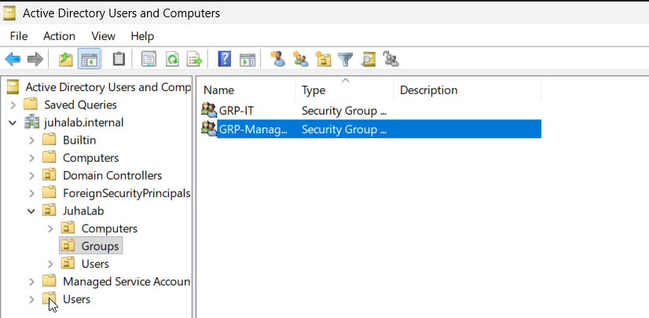
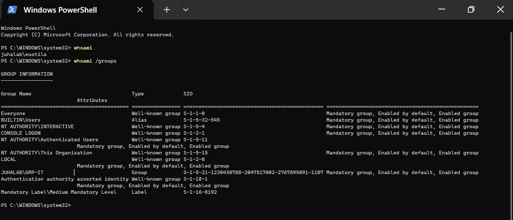

# 06 - Ryhmät ja kirjautumistesti

Tein 10.11.2026.

## Ryhmät

Tein kaksi ryhmää JuhaLab → Groups -kansioon (hiiren oikea → New → Group):

| Ryhmä | Scope | Type | Jäsenet |
|---|---|---|---|
| GRP-IT | Global | Security | Eemeli Uotila (euotila) |
| GRP-Management | Global | Security | Arttu Mäkelä (amakela) |



**Security vai Distribution:** Security-ryhmälle voi antaa oikeuksia, esim. jaettuun kansioon tai GPO:hon.
Distribution-ryhmä on pelkkä sähköpostin jakelulista. Käytin siis Security-ryhmiä.

**Global:** Ryhmään voi lisätä vain saman domainin käyttäjiä, mutta sille voi antaa oikeuksia muuallakin.
Tavallisin valinta käyttäjäryhmille. Domain local ja Universal tulevat vastaan vasta isommissa ympäristöissä.

**GRP-etuliite:** Nimeämiskäytäntö, josta näkee heti että kyseessä on ryhmä eikä käyttäjä tai kone.

Käyttäjät lisäsin ryhmään näin: ryhmä auki → Members → Add... → tunnus → Check Names → OK.
Jäsenyyden näkee myös käyttäjän puolelta Member Of -välilehdeltä.


## Kirjautumistesti CLIENT01:llä

Kirjauduin CLIENT01:lle domain-käyttäjänä: Other user → `JUHALAB\euotila`.
Ensimmäinen kirjautuminen kesti hetken, koska Windows loi käyttäjälle profiilin.
(Salasana oli unohtunut, ks. [troubleshooting](troubleshooting.md).)

Tarkistin PowerShellillä, kuka olen ja mihin ryhmiin kuulun:

```powershell
whoami
whoami /groups
```

`whoami` näytti `juhalab\euotila` ja `whoami /groups` -listassa näkyi `JUHALAB\GRP-IT`.
Eli domain-kirjautuminen toimii ja ryhmäjäsenyys tulee mukaan kirjautuessa.



## Seuraavaksi

- GPO (esim. salasanakäytäntö tai taustakuva)
- PowerShell-skripti, joka luo käyttäjiä kerralla
- DNS forwarder ja reverse lookup zone
