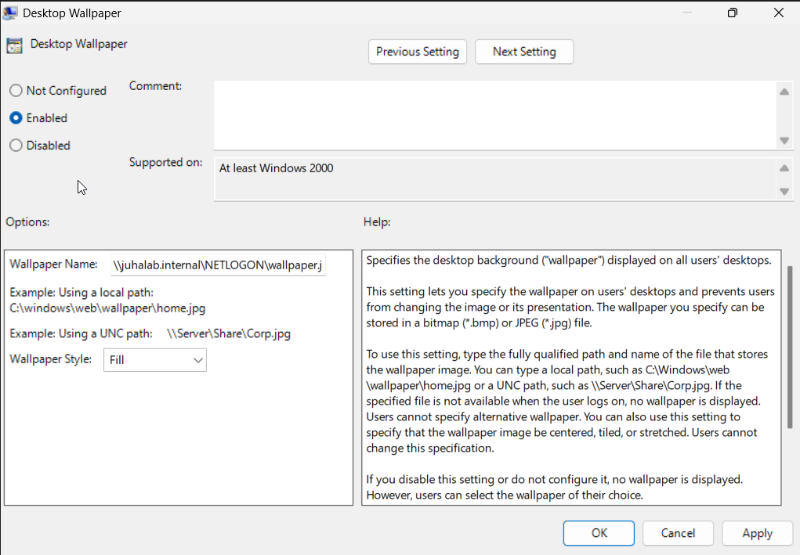
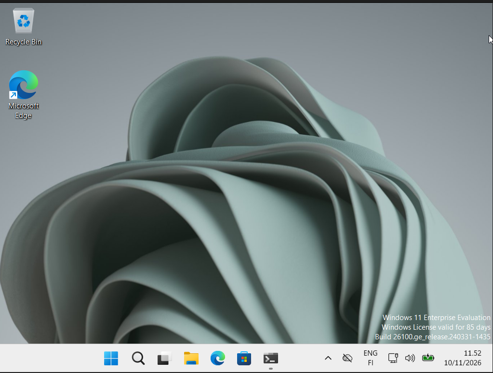
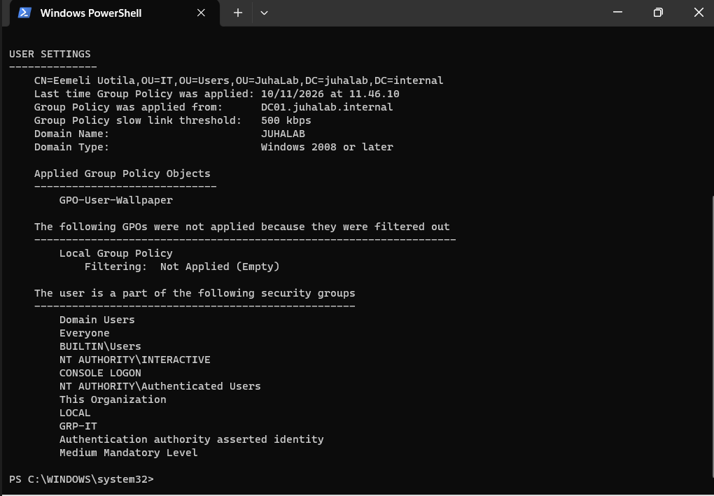
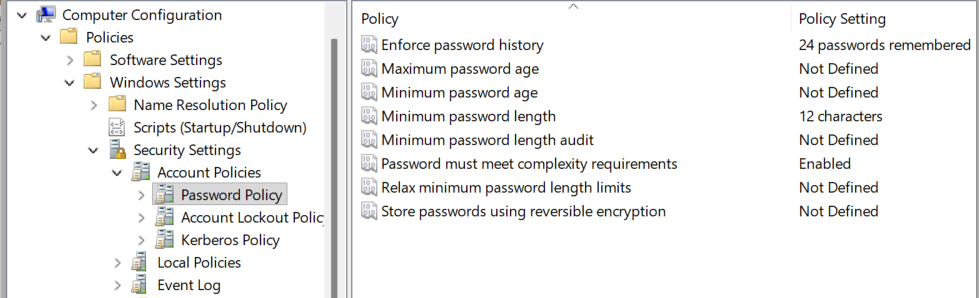
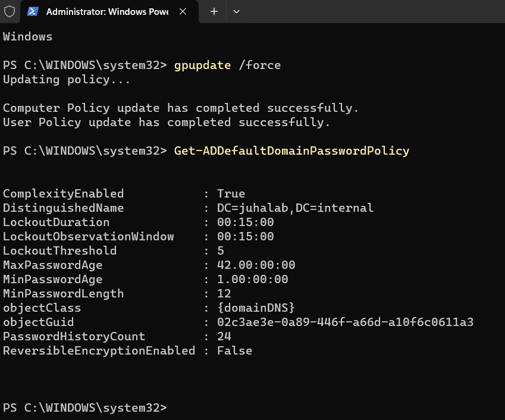
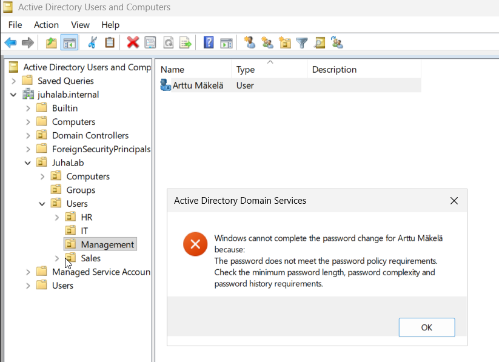
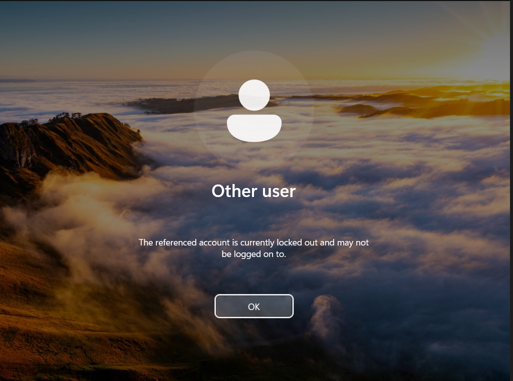
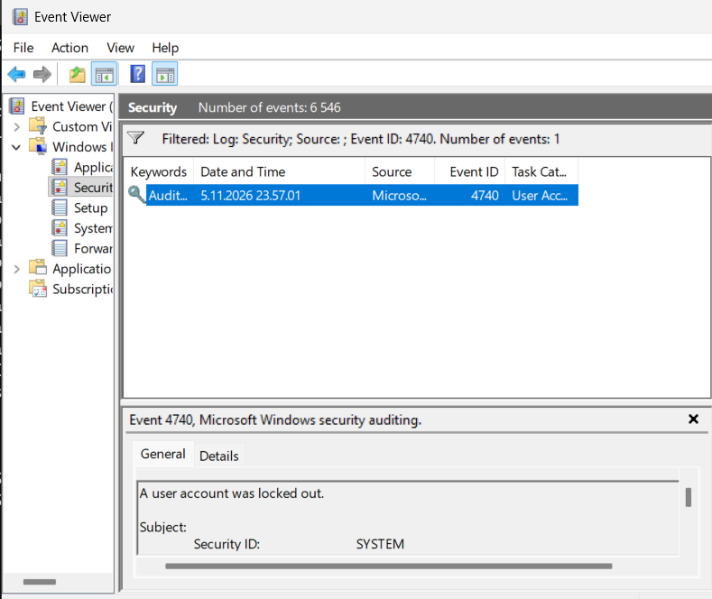
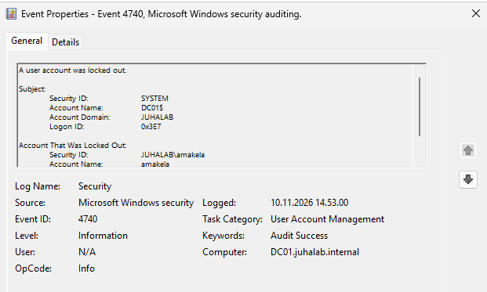
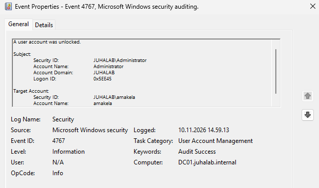

# 07 - Ryhmäkäytännöt (GPO)

Tein 10.11.2026.

GPO (Group Policy Object) on joukko asetuksia, jotka DC jakaa keskitetysti koneille ja käyttäjille.
Asetuksia ei siis tarvitse säätää jokaisella koneella erikseen. GPO tehdään ja linkitetään
**Group Policy Managementissa** (Server Manager → Tools → Group Policy Management).

Tein kaksi GPO:ta:

| GPO | Linkitetty | Puoli | Mitä tekee |
|---|---|---|---|
| GPO-User-Wallpaper | JuhaLab → Users (OU) | User Configuration | Sama taustakuva kaikille käyttäjille |
| GPO-Domain-PasswordPolicy | juhalab.internal (domainin juuri) | Computer Configuration | Salasana- ja lukituskäytäntö |

## GPO 1: Taustakuva

### Kuva jaettuun kansioon

Kuvan pitää olla paikassa, josta jokainen domain-käyttäjä pystyy lukemaan sen. Laitoin sen DC01:n
valmiiseen **NETLOGON**-jakoon:

- Kansio DC01:llä: `C:\Windows\SYSVOL\sysvol\juhalab.internal\scripts`
- Sama verkon kautta: `\\juhalab.internal\NETLOGON\wallpaper.jpg`

Kuva on Windowsin valmis taustakuva kansiosta `C:\Windows\Web\Wallpaper`.

### GPO:n teko

1. JuhaLab → Users → hiiren oikea → **Create a GPO in this domain, and Link it here...** → `GPO-User-Wallpaper`
2. GPO → Edit → **User Configuration → Policies → Administrative Templates → Desktop → Desktop → Desktop Wallpaper**
3. Enabled, Wallpaper Name `\\juhalab.internal\NETLOGON\wallpaper.jpg`, Wallpaper Style **Fill**



Asetus on User Configuration -puolella, koska taustakuva on käyttäjän asetus. Siksi GPO on linkitetty
käyttäjien OU:hun. Linkki koskee kaikkia Users-OU:n alikansioita (HR, IT, Management, Sales).
AD:n valmiiseen Users-kansioon tätä ei olisi voinut linkittää, koska se ei ole oikea OU.

### Testaus CLIENT01:llä

Kirjauduin Eemelinä ja ajoin:

```powershell
gpupdate /force   # hakee GPO:t heti, muuten ne päivittyvät ~90 min välein
gpresult /r       # näyttää mitkä GPO:t ovat voimassa
```

Taustakuva vaihtui heti, eikä tarvinnut edes kirjautua uudelleen.



`gpresult /r` -tuloksessa kohdassa USER SETTINGS → Applied Group Policy Objects näkyy
GPO-User-Wallpaper, ja se tuli DC01.juhalab.internalilta.



## GPO 2: Salasanakäytäntö

### Tärkein juttu: linkitys domainin juureen

Domain-käyttäjien salasanakäytäntö toimii **vain domainin juureen linkitetystä GPO:sta**.
Jos sen linkittää OU:hun, se ei vaikuta domain-tileihin. (Jos eri ryhmille tarvitaan eri
salasanasäännöt, siihen on oma työkalunsa: Fine-Grained Password Policy.)

Tein oman GPO:n enkä muokannut Default Domain Policya. Näin näkee heti, mitä on muutettu,
ja muutokset saa peruttua koskematta Microsoftin oletuksiin.

1. juhalab.internal → hiiren oikea → **Create a GPO in this domain, and Link it here...** → `GPO-Domain-PasswordPolicy`
2. Linked Group Policy Objects -välilehdellä nostin sen ylimmäksi (**Link Order 1**). Pienin numero voittaa, jos asetukset ovat ristiriidassa.

### Asetukset

**Computer Configuration → Policies → Windows Settings → Security Settings → Account Policies**

Password Policy:

| Asetus | Arvo |
|---|---|
| Enforce password history | 24 |
| Minimum password length | 12 merkkiä |
| Password must meet complexity requirements | Enabled |

Account Lockout Policy:

| Asetus | Arvo |
|---|---|
| Account lockout threshold | 5 väärää yritystä |
| Account lockout duration | 15 min |
| Reset account lockout counter after | 15 min |



Miksi nämä:
- **12 merkkiä**, koska pituus suojaa paremmin kuin monimutkaisuus (myös NIST suosittelee pituutta).
- **Lukitus 5 yrityksen jälkeen** estää salasanan arvaamisen (brute force). Liian tiukka raja,
  esim. 3, tekisi vain turhia helpdesk-tikettejä.

### Tarkistus

DC01:llä:

```powershell
gpupdate /force
Get-ADDefaultDomainPasswordPolicy
```



Arvot näkyivät oikein. MaxPasswordAge (42 päivää) ja MinPasswordAge (1 päivä) tulevat
Default Domain Policysta, koska en määrittänyt niitä omassa GPO:ssani. Siitä näkee hyvin,
miten GPO:t yhdistyvät.

### Testi 1: liian lyhyt salasana

Yritin vaihtaa Artulle 9-merkkisen salasanan ADUC:n Reset Passwordilla. Windows hylkäsi sen.



Olemassa olevat salasanat eivät muutu käytännön myötä, vaan uusi sääntö tulee voimaan vasta
seuraavassa salasanan vaihdossa.

### Testi 2: tilin lukitus

Ensin selvisi, että Artun tili oli disabled-tilassa (ks. [troubleshooting](troubleshooting.md)).
Kun sain sen kuntoon, syötin CLIENT01:llä väärän salasanan 5 kertaa. Windows 11 hidasti
yrityksiä välissä ("Invalid credentials, delaying next attempt"). Se on Windowsin oma suojaus,
ei minun GPO:ni. Kuudennella kerralla tili oli lukossa.



DC01:llä lukitut tilit löytyvät ja aukeavat PowerShellillä:

```powershell
Search-ADAccount -LockedOut
Unlock-ADAccount -Identity amakela
```

Väärien yritysten määrän näkee näin:

```powershell
Get-ADUser amakela -Properties badPwdCount, LockedOut | Select-Object Name, badPwdCount, LockedOut
```

### Lukitus lokeissa

Lukitus ja avaus jäävät DC01:n Security-lokiin (Event Viewer → Windows Logs → Security → Filter Current Log):

| Event ID | Tarkoittaa |
|---|---|
| 4740 | Tili lukittui |
| 4767 | Admin avasi lukituksen |
| 4722 | Tili otettiin käyttöön (enable) |



(Kuvassa päiväys on väärä, 5.11., koska DC01:n kello oli jäljessä. Ks. [troubleshooting](troubleshooting.md).)

Kun kello oli korjattu, tein testin uudelleen. Nyt päiväys on oikein. Lukituksen kirjasi
SYSTEM / DC01$, eli DC lukitsi tilin itse GPO:n mukaan:



Lukon avauksesta jäi 4767. Siinä näkyy, kuka avasi (JUHALAB\Administrator) ja kenen tilin (amakela):



**Locked vs. disabled:** locked aukeaa itsestään (15 min) tai `Unlock-ADAccount`-komennolla,
disabled vain adminin `Enable-ADAccount`-komennolla.

## Seuraavaksi

- PowerShell-skripti, joka luo käyttäjiä kerralla
- DNS forwarder ja reverse lookup zone
