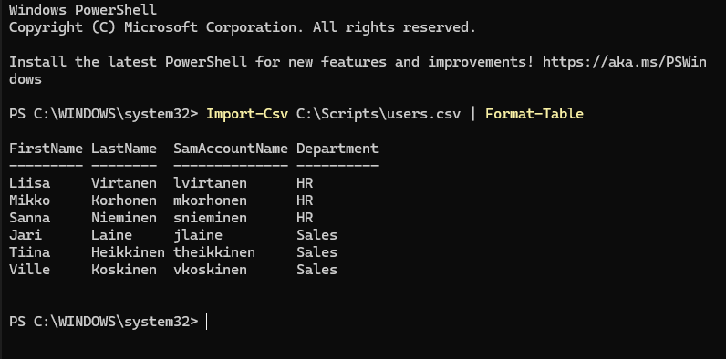
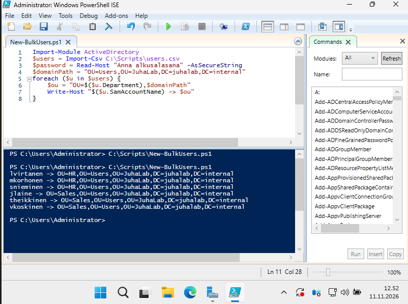
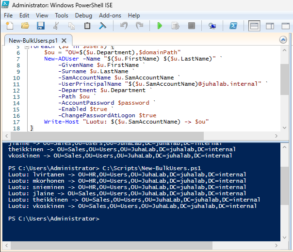
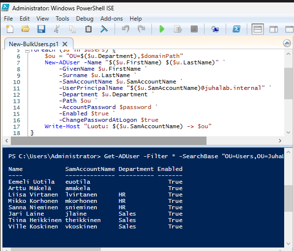

# 08 - Käyttäjien massaluonti PowerShellillä

Tein 11.11.2026.

Aiemmin loin käyttäjät käsin Active Directory Users and Computersissa. Se toimii parille
käyttäjälle, mutta isommassa yrityksessä uusia työntekijöitä tulee jatkuvasti. Tein siksi skriptin, joka
lukee käyttäjät CSV-tiedostosta ja luo ne kerralla oikeisiin OU:ihin. Täytin sillä HR- ja Sales-OU:t.

Tiedostot repossa:
- [`scripts/users.csv`](../scripts/users.csv) - käyttäjälista
- [`scripts/New-BulkUsers.ps1`](../scripts/New-BulkUsers.ps1) - itse skripti

DC01:llä molemmat ovat kansiossa `C:\Scripts`.

## 1. CSV-tiedosto

CSV (Comma-Separated Values) on tekstitiedosto, jossa jokainen rivi on yksi tietue ja sarakkeet
erotetaan pilkuilla. Ensimmäinen rivi kertoo sarakkeiden nimet. Sen voi tehdä Notepadilla
tai Excelillä.

```
FirstName,LastName,SamAccountName,Department
Liisa,Virtanen,lvirtanen,HR
...
```

Department-sarake ratkaisee, mihin OU:hun käyttäjä menee.

Notepadissa tallennuksessa pitää valita **Save as type → All files**, muuten Windows lisää
loppuun .txt:n.

Tarkistin, että PowerShell lukee tiedoston oikein:

```powershell
Import-Csv C:\Scripts\users.csv | Format-Table
```



## 2. Skripti PowerShell ISE:ssä

Kirjoitin skriptin PowerShell ISE:ssä, joka sopii hyvin tällaiseen käyttäjien luontiin ja
automatisointiin. Avasin sen järjestelmänvalvojana (hae `ise` → hiiren oikea → **Run as administrator**).

Skriptin osat:

- `Import-Module ActiveDirectory` lataa AD-komennot käyttöön.
- `Import-Csv` lukee CSV:n muuttujaan `$users`.
- `Read-Host -AsSecureString` kysyy alkusalasanan ajon aikana. Salasanaa ei kirjoiteta skriptiin,
  koska skripti on julkisesti GitHubissa. `-AsSecureString` piilottaa kirjoitetut merkit.
- `foreach`-silmukka käy CSV:n rivit läpi yksi kerrallaan. `$u` on vuorossa oleva käyttäjä ja
  `$u.Department` sen Department-sarake.
- `New-ADUser` luo käyttäjän. Sama asia kuin käsin ADUC:ssa, mutta komennolla.
  Rivien lopun takahipsu ` tarkoittaa, että komento jatkuu seuraavalla rivillä.

Tärkeimmät New-ADUser-parametrit:

| Parametri | Mitä tekee |
|---|---|
| `-Path` | Mihin OU:hun käyttäjä luodaan |
| `-UserPrincipalName` | Kirjautumisnimi muodossa `nimi@juhalab.internal` |
| `-AccountPassword` | Alkusalasana |
| `-Enabled $true` | Tili käyttöön heti |
| `-ChangePasswordAtLogon $true` | Pakottaa vaihtamaan salasanan ensimmäisellä kirjautumisella |

Alkusalasanan pitää täyttää domainin salasanakäytäntö (vähintään 12 merkkiä + monimutkaisuus,
ks. [07 - GPO](07-gpo.md)), muuten New-ADUser antaa virheen.

## 3. Kuivaharjoitus ensin

Ennen kuin skripti sai luoda mitään, laitoin silmukkaan pelkän `Write-Host`-rivin, joka vain
tulostaa mihin OU:hun kukin käyttäjä menisi. Näin näki heti, että OU-polut ovat oikein, eikä
AD:hen syntynyt virheellisiä käyttäjiä, jos jokin oli pielessä.

```powershell
foreach ($u in $users) {
    $ou = "OU=$($u.Department),$domainPath"
    Write-Host "$($u.SamAccountName) -> $ou"
}
```



## 4. Oikea ajo

Vaihdoin `Write-Host`-rivin tilalle New-ADUserin ja ajoin skriptin F5:llä. Kaikki kuusi käyttäjää
syntyivät ilman virheitä.



## 5. Tarkistus

**Get-ADUser** hakee käyttäjiä AD:sta. `-SearchBase` rajaa haun tiettyyn OU:hun.

```powershell
Get-ADUser -Filter * -SearchBase "OU=Users,OU=JuhaLab,DC=juhalab,DC=internal" -Properties Department |
    Select-Object Name, SamAccountName, Department, Enabled | Format-Table
```



Uudet käyttäjät ovat oikeissa osastoissa ja tilit päällä. Huomasin samalla, että käsin tehdyiltä
euotilalta ja amakelalta puuttuu Department-tieto. Skripti tekee asiat joka kerta samalla tavalla,
kun taas käsin jotain unohtuu helposti.

## Mitä opin

- Kuivaharjoitus kannattaa aina ennen kuin skripti muuttaa mitään.
- Salasanoja ei kirjoiteta skripteihin.
- Uudelleenajo antaisi virheen, koska käyttäjät on jo olemassa. Jatkossa skriptiin voisi lisätä
  tarkistuksen (`Get-ADUser`), joka ohittaa jo olemassa olevat käyttäjät.
