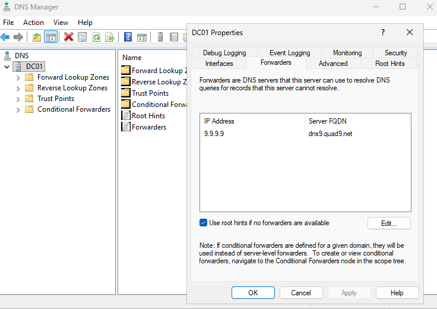
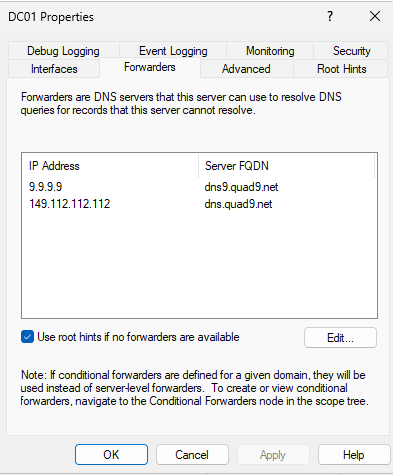
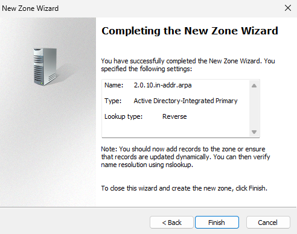
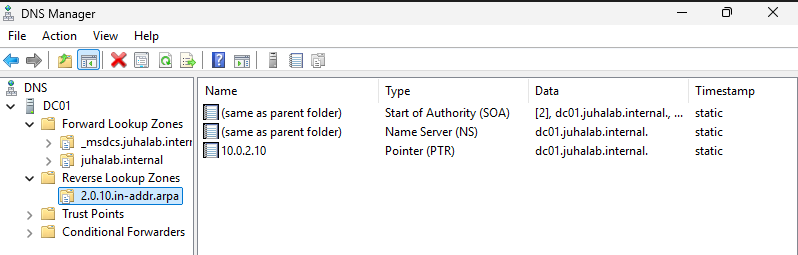

# 09 - DNS: forwarder ja reverse lookup zone

Tein 12.11.2026.

DC01 on domainin DNS-palvelin. CLIENT01 kysyy siltä kaikki nimet, myös internetin osoitteet.
Kävin läpi kaksi DNS:n perusasetusta: forwarderin ja reverse lookup zonen. Kumpikaan ei
korjannut mitään rikkinäistä, koska netti ja domain toimivat jo. Halusin kuitenkin ymmärtää,
mihin nimikyselyt oikeasti kulkevat, ja viimeistellä DNS:n niin kuin oikeassa ympäristössä tehdään.

```
CLIENT01 → kysyy DC01:ltä → DC01 vastaa itse (juhalab.internal)
                          → tai välittää forwarderille (esim. google.com)
```

Työkaluna oli **DNS Manager** (Server Manager → Tools → DNS).

## 1. Forwarder

DC01 tuntee vain oman domaininsa nimet. **Forwarder** on palvelin, jolle DC01 välittää muut
kyselyt, esim. `google.com`. Käytän Quad9:ää.

### Lähtötilanne

DC01 → hiiren oikea → Properties → Forwarders

Forwarderina oli jo `9.9.9.9`. Windows lisäsi sen itse promotoinnin yhteydessä, koska DC01:n
verkkokortissa oli alternate DNS 9.9.9.9 (ks. [02 - DC01:n asennus](02-dc01-install.md)).



**Use root hints if no forwarders are available** jäi päälle. Jos forwarderit eivät vastaa,
DC01 kysyy suoraan internetin juuripalvelimilta.

### Toinen forwarder varalle

Yhdellä forwarderilla nimikyselyt hidastuvat tai katkeavat, jos se ei vastaa. Lisäsin Quad9:n
varaosoitteen: Edit... → `149.112.112.112` → OK → Apply.



### Testi

DC01:llä:

```
PS> nslookup google.com
Non-authoritative answer:
Name:    google.com
Addresses:  2a00:1450:4010:c0e::8a
          ...
          74.125.131.101
          ...
```

**Non-authoritative answer** tarkoittaa, ettei DC01 omista nimeä itse, vaan sai vastauksen
forwarderilta. Juuri näin kuuluu toimia.

## 2. Reverse lookup zone

Tavallinen DNS-haku (forward lookup) kääntää nimen osoitteeksi: `dc01.juhalab.internal` → `10.0.2.10`.
**Reverse lookup** tekee päinvastoin: `10.0.2.10` → `dc01.juhalab.internal`. Tietueen nimi on
**PTR** (pointer).

Siitä on hyötyä esim. lokeissa ja vianetsinnässä, kun tiedossa on pelkkä IP-osoite ja halutaan
tietää, mikä kone on kyseessä. Ennen tätä `nslookup` näytti aina "Server: UnKnown", koska DNS-palvelimen
osoitteelle ei löytynyt nimeä (ks. [03 - Active Directory](03-active-directory.md)).

### Zonen luonti

Reverse Lookup Zones → hiiren oikea → New Zone...

| Sivu | Valinta |
|---|---|
| Zone Type | Primary zone, Store the zone in Active Directory |
| Replication Scope | To all DNS servers running on domain controllers in this domain |
| Zone Name | IPv4 Reverse Lookup Zone |
| Network ID | `10.0.2` |
| Dynamic Update | Allow only secure dynamic updates |



Zonen nimeksi tuli `2.0.10.in-addr.arpa`. Osoite on käännetty väärin päin, koska DNS-nimissä
tarkin osa on vasemmalla ja laajin oikealla (kuten `dc01.juhalab.internal`), mutta IP-osoitteessa
laajin osa on vasemmalla. `in-addr.arpa` on DNS:n osa, joka on varattu käänteiselle haulle.

**Allow only secure dynamic updates** tarkoittaa, että vain domainiin liitetyt koneet saavat
päivittää omat tietueensa. Se on AD:ssa suositeltu asetus.

### PTR-tietue DC01:lle

Forward Lookup Zones → juhalab.internal → dc01 (Host (A), 10.0.2.10) → ruksi
**Update associated pointer (PTR) record** → OK.

Sen jälkeen reverse zonessa näkyi DC01:n PTR-tietue. SOA- ja NS-tietueet tulevat jokaiseen
zoneen automaattisesti.



### Testi

```
PS> nslookup 10.0.2.10
Server:  UnKnown
Address:  ::1

Name:    dc01.juhalab.internal
Address:  10.0.2.10
```

Käänteinen haku toimii: osoitteesta saatiin nimi. "Server"-rivillä lukee DC01:llä yhä UnKnown,
koska DC01 kysyy DNS:ää itseltään IPv6-osoitteesta `::1`, jolle ei ole PTR-tietuetta. Se ei
ole virhe. CLIENT01:llä, jonka DNS on 10.0.2.10, Server-rivillä pitäisi näkyä dc01.juhalab.internal.

## Mitä opin

- Mikään ei ollut rikki, mutta nyt tiedän, mitä reittiä työaseman nimikyselyt kulkevat. Kun
  "netti ei toimi" tai kirjautuminen ei onnistu, DNS on yksi ensimmäisistä tarkistettavista asioista.
- Windows tekee osan asetuksista automaattisesti. Asetukset kannattaa tarkistaa ennen kuin
  muuttaa mitään.
- Forwardereita kannattaa olla vähintään kaksi.
- `nslookup`-tulosteen rivit: Server = keneltä kysyttiin, Non-authoritative = vastaus tuli muualta.
