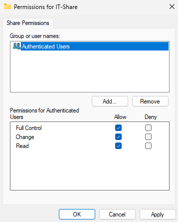
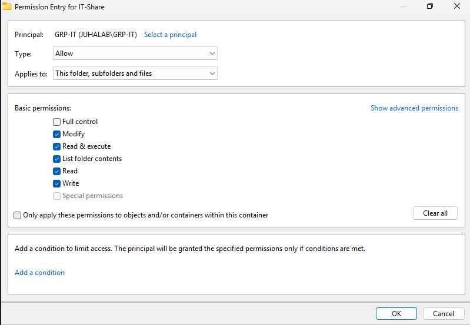
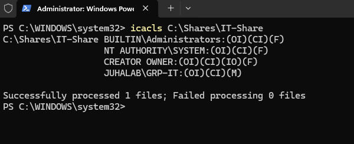
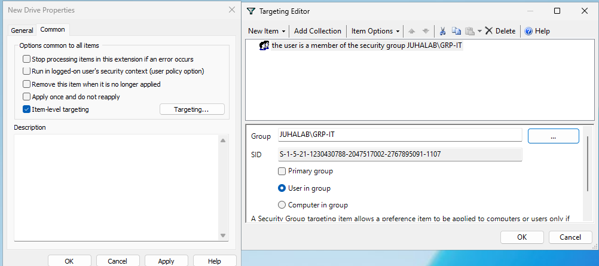
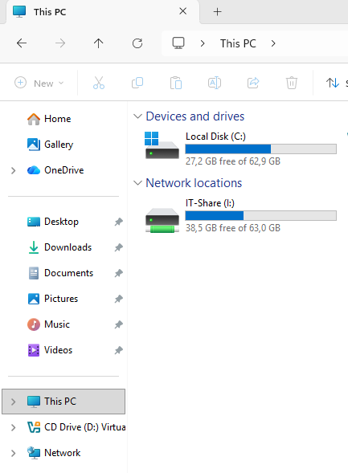
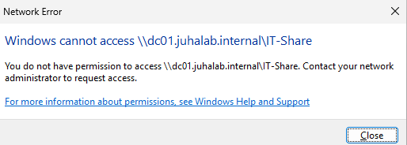

# 10 - Jaettu kansio ja verkkoasema GPO:lla

Tein 12.11.2026 ja 18.11.2026.

Firma tarvitsi ensimmäisen yhteisen verkkolevyn. Tein DC01:lle kansion `IT-Share`, johon pääsee vain
IT-osasto (GRP-IT). Lopuksi GPO liittää kansion IT-väelle automaattisesti asemaksi `I:`.

Oikeassa yrityksessä tiedostot eivät ole ihmisten omilla koneilla. Ne ovat yhteisillä verkkolevyillä,
ja oikeudet annetaan ryhmille eikä yksittäisille ihmisille. Kun joku vaihtaa osastoa, hänet siirretään
vain toiseen ryhmään, eikä kansioiden oikeuksiin tarvitse koskea. 

## Kaksi oikeuskerrosta

Jaetussa kansiossa on kaksi oikeuskerrosta:

- **Share-oikeudet**: kuka pääsee kansioon *verkon kautta* (ulko-ovi)
- **NTFS-oikeudet**: mitä kansiossa saa tehdä, eli lukea, muokata tai poistaa (huoneen ovi)

Molempien pitää päästää läpi. Yleinen käytäntö on avata share-oikeudet laajasti ja rajata varsinaiset
oikeudet NTFS:llä. Tein samoin, koska kun rajaus on vain yhdessä paikassa, oikeuksia on helpompi
hallita ja vianetsintä on selkeämpää.

## 1. Kansio

DC01: File Explorer → Local Disk (C:) → uusi kansio `Shares` ja sen sisään `IT-Share`.

Lopputulos: `C:\Shares\IT-Share`

## 2. Share-oikeudet

IT-Share → Properties → Sharing → Advanced Sharing... → **Share this folder** (nimi `IT-Share`) → Permissions

- Poistin **Everyone**-rivin.
- Lisäsin **Authenticated Users**: Full Control, Allow.



**Miksi Authenticated Users eikä Everyone:** Everyone tarkoittaa kirjaimellisesti kaikkia, myös
kirjautumattomia. Authenticated Users tarkoittaa vain domain-tunnuksella kirjautuneita.

## 3. NTFS-oikeudet

IT-Share → Properties → Security → Advanced

Kansio perii oikeudet yläkansioltaan (`C:\`), ja sieltä tuli mukana myös **Users**-ryhmä, eli
kaikki käyttäjät. Ensin piti siis katkaista perintä (inheritance):

1. **Disable inheritance** → **Convert inherited permissions into explicit permissions on this object**
2. Poistin **Users**-rivit. Jätin Administrators-, SYSTEM- ja CREATOR OWNER -rivit, koska niitä
   tarvitaan, jotta ylläpitäjä ja Windows pääsevät kansioon.
3. Add → Select a principal → `GRP-IT` → **Modify**, This folder, subfolders and files



**Miksi Modify eikä Full Control:** Modify antaa luoda, muokata ja poistaa tiedostoja. Full Control
antaisi lisäksi oikeuden muuttaa kansion oikeuksia, eikä tavallisen käyttäjän pidä voida tehdä sitä.

### Tarkistus icacls-komennolla

`icacls` näyttää kansion NTFS-oikeudet tekstinä. 

```
PS> icacls C:\Shares\IT-Share
C:\Shares\IT-Share BUILTIN\Administrators:(OI)(CI)(F)
                   NT AUTHORITY\SYSTEM:(OI)(CI)(F)
                   CREATOR OWNER:(OI)(CI)(IO)(F)
                   JUHALAB\GRP-IT:(OI)(CI)(M)
```



`BUILTIN\Users` on poissa, joten kansioon pääsee vain GRP-IT.

| Merkintä | Tarkoittaa |
|---|---|
| **F** | Full control |
| **M** | Modify |
| **(OI)(CI)** | Oikeus periytyy kansion tiedostoihin (Object Inherit) ja alikansioihin (Container Inherit) |
| **(IO)** | Inherit Only: koskee vain kansion sisältöä, ei itse kansiota. CREATOR OWNER = tiedoston luoja saa oikeudet omaan tiedostoonsa. |

## 4. GPO verkkoasemalle

Group Policy Management → juhalab.internal → JuhaLab → Users → hiiren oikea →
**Create a GPO in this domain, and Link it here...** → `GPO-User-DriveMap-IT`

Tein asemalle oman GPO:n, kuten aiemmin taustakuvalle ja salasanapolitiikalle. Kun jokaisella GPO:lla
on yksi tehtävä, näkee heti, mikä asetus tulee mistäkin.

GPO on linkitetty koko Users-OU:hun eikä pelkkään IT-OU:hun, koska rajaus tehdään **ryhmän**
perusteella (kohta 6). Jos joku Salesista lisätään myöhemmin GRP-IT:hen, hänkin saa aseman automaattisesti.

## 5. Drive Map -asetus

GPO-User-DriveMap-IT → Edit → **User Configuration → Preferences → Windows Settings → Drive Maps** →
hiiren oikea → New → Mapped Drive

| Kenttä | Arvo |
|---|---|
| Action | Update |
| Location | `\\dc01.juhalab.internal\IT-Share` |
| Reconnect | päällä |
| Label as | `IT-Share` |
| Drive Letter | Use: `I` |

- **User Configuration**, koska asema kuuluu käyttäjälle eikä koneelle. Asema seuraa käyttäjää,
  kirjautuipa hän mille koneelle tahansa.
- **Preferences**: aiemmat GPO:t tein Policies-puolella. Preferences-puolelta löytyvät "arjen
  asetukset", kuten verkkoasemat, tulostimet ja pikakuvakkeet.
- **Update** luo aseman, jos sitä ei vielä ole, ja korjaa sen, jos asetukset ovat muuttuneet.

## 6. Rajaus GRP-IT:lle (Item-level targeting)

Samassa ikkunassa: Common → ruksi **Item-level targeting** → Targeting... → New Item → **Security Group**
→ `JUHALAB\GRP-IT`, **User in group**

**Item-level targeting** rajaa yksittäisen asetuksen koskemaan vain niitä, jotka täyttävät ehdon.
GPO koskee koko Users-OU:ta, mutta asema tulee vain GRP-IT:n jäsenille.



## 7. Testit CLIENT01:llä

### euotila (IT): pitäisi päästä

Kirjauduin `JUHALAB\euotila`. GPO:t haetaan kirjautuessa, joten mitään ei tarvinnut tehdä käsin.
This PC:ssä näkyi heti **IT-Share (I:)**.



Tein asemalle tiedoston `testi-euotila.txt`, ja se onnistui. Modify-oikeus siis toimii.

### amakela (Management): ei pitäisi päästä

Kirjauduin `JUHALAB\amakela`.

- I:-asemaa ei näkynyt (Item-level targeting toimii).
- Kirjoitin Explorerin osoiteriville `\\dc01.juhalab.internal\IT-Share` ja sain virheilmoituksen,
  jonka mukaan käyttöoikeutta ei ole (NTFS-oikeudet toimivat).



Testasin molemmat asiat, koska pelkkä aseman piilottaminen ei ole tietoturvaa. Kuka tahansa voi
kirjoittaa osoitteen käsin. Vasta NTFS-oikeudet oikeasti estävät pääsyn.

## Mitä opin

- Share- ja NTFS-oikeudet ovat eri kerroksia. Kun "käyttäjä ei pääse kansioon", molemmat pitää tarkistaa.
- Oikeudet annetaan ryhmille, ei ihmisille. Osaston vaihto = ryhmän vaihto.
- Perintä tuo kansioon oikeuksia yläkansiosta. Ne pitää muistaa tarkistaa.
- `icacls` on nopea tapa nähdä, kenellä on pääsy kansioon.
- GPO:n Preferences-puoli ja Item-level targeting: yksi GPO voi koskea koko OU:ta, mutta
  yksittäinen asetus vain tiettyä ryhmää.
- Piilottaminen ei ole suojaamista. Pääsy pitää estää oikeuksilla.
