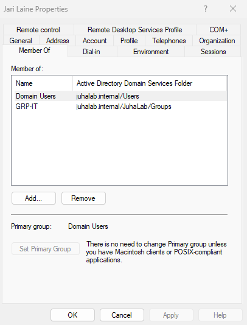
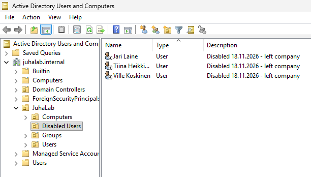
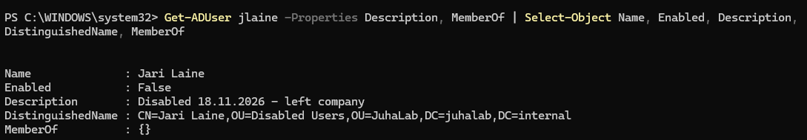
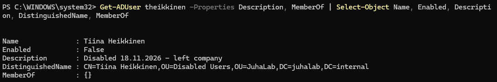
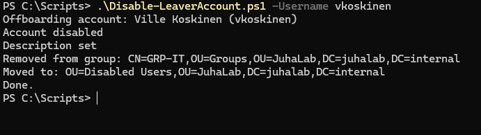

# 11 - Käyttäjän poistuminen (offboarding)

Tein 18.11.2026.

Työntekijä lähtee firmasta, ja hänen tilinsä suljetaan hallitusti. Bulk-skripti
([08](08-powershell-bulk-users.md)) hoitaa käyttäjän tulon, ja tämä täydentää elinkaaren
(tulo → muutokset → lähtö).

Offboardingissa tilille tehdään neljä asiaa:

1. **Disable**: tilillä ei voi enää kirjautua.
2. **Kuvaus**: tilistä näkee, miksi ja milloin se suljettiin.
3. **Ryhmistä poisto**: tilillä ei ole enää oikeuksia mihinkään.
4. **Siirto** omaan OU:hun `Disabled Users`.

**Miksi disable eikä poisto:** poistettua tiliä ei saa helposti takaisin. Jos lähtijän tiedostoja
tai oikeuksia vielä tarvitaan, tai tili suljettiin vahingossa, disabloidun tilin voi vain ottaa
uudelleen käyttöön. Monessa firmassa tili poistetaan lopullisesti vasta esim. 30–90 päivän päästä.

**Miksi tämä on tärkeää:** unohtuneet vanhat tilit ovat yleinen hyökkäysreitti, koska lähteneen
työntekijän salasana saattaa yhä toimia. Offboarding on siis sekä ylläpitoa että tietoturvaa.

Tein sen kolmeen kertaan: ensin käsin (jlaine), sitten komento kerrallaan PowerShellillä
(theikkinen) ja lopuksi skriptillä (vkoskinen). Kaikki kolme ovat Sales-OU:n testikäyttäjiä.

## 1. OU Disabled Users

Active Directory Users and Computers → JuhaLab → hiiren oikea → New → Organizational Unit →
`Disabled Users` (Protect container from accidental deletion jäi päälle).

Disabled Users ei ole Users-OU:n alla, joten Users-OU:hun linkitetyt GPO:t (taustakuva, I:-asema)
eivät koske suljettuja tilejä lainkaan.

## 2. Käsin: jlaine

### Lähtötilanne

jlaine → Properties → Member Of: vain **Domain Users**. Bulk-skripti ei lisännyt käyttäjiä ryhmiin.

Domain Users on jokaisen käyttäjän oletusryhmä (primary group). Sitä ei voi poistaa, eikä tarvitse,
koska disabloidulle tilille se ei anna mitään.

Jotta ryhmistä poistoa pääsi harjoittelemaan, lisäsin jlainelle ensin GRP-IT:n. Kuvitellaan, että
myyjä on tehnyt yhteistyötä IT:n kanssa ja saanut pääsyn IT-Shareen. 



### Sulkeminen

Järjestyksellä on väliä. Disable tehdään ensin, koska se katkaisee pääsyn heti. Muut vaiheet ovat siivousta.

1. jlaine → hiiren oikea → **Disable Account**. Kuvakkeeseen tuli alaspäin osoittava nuoli.
2. Properties → Member Of → GRP-IT → **Remove**
3. General → Description: `Disabled 18.11.2026 - left company`
4. hiiren oikea → **Move...** → JuhaLab → Disabled Users

Kuva on otettu lopuksi, joten Disabled Users -OU:ssa näkyvät jo kaikki kolme suljettua tiliä
(jlaine sekä kohtien 3 ja 4 theikkinen ja vkoskinen).



### Tarkistus

```powershell
Get-ADUser jlaine -Properties Description, MemberOf | Select-Object Name, Enabled, Description, DistinguishedName, MemberOf
```



`Enabled: False`, DistinguishedNamessa `OU=Disabled Users` ja `MemberOf` tyhjä. Domain Users ei näy
MemberOf-kentässä, koska primary group tallennetaan eri tavalla.

## 3. PowerShellillä: theikkinen

Valmistelu (ylimääräinen ryhmä, jotta poistettavaa on):

```powershell
Add-ADGroupMember -Identity GRP-IT -Members theikkinen
```

Sulkeminen samassa järjestyksessä kuin käsin:

```powershell
# 1. Disable
Disable-ADAccount -Identity theikkinen

# 2. Kuvaus
Set-ADUser -Identity theikkinen -Description "Disabled 18.11.2026 - left company"

# 3. Poisto kaikista ryhmistä
Get-ADUser theikkinen -Properties MemberOf | Select-Object -ExpandProperty MemberOf | ForEach-Object { Remove-ADGroupMember -Identity $_ -Members theikkinen -Confirm:$false }

# 4. Siirto
Get-ADUser theikkinen | Move-ADObject -TargetPath "OU=Disabled Users,OU=JuhaLab,DC=juhalab,DC=internal"
```

Ryhmien poistossa komento hakee ryhmät itse, koska oikeassa tilanteessa ei tiedä etukäteen, mihin
kaikkiin ryhmiin lähtijä kuuluu. `ForEach-Object` käy ne läpi yksi kerrallaan (`$_` = käsiteltävä ryhmä),
ja `-Confirm:$false` estää "Are you sure?" -kysymyksen joka ryhmän kohdalla.



## 4. Skriptillä: vkoskinen

Kokosin komennot skriptiksi [Disable-LeaverAccount.ps1](../scripts/Disable-LeaverAccount.ps1).
DC01:llä se on kansiossa `C:\Scripts`. Kun joku lähtee, ajetaan yksi komento, eikä mikään vaihe unohdu.

```powershell
Add-ADGroupMember -Identity GRP-IT -Members vkoskinen   # valmistelu
cd C:\Scripts
.\Disable-LeaverAccount.ps1 -Username vkoskinen
```



Skriptin yksityiskohdat:

- `param(...)` + `Mandatory = $true`: käyttäjätunnus annetaan ajon yhteydessä, ja jos se unohtuu,
  PowerShell kysyy sitä. Sama skripti toimii kenelle tahansa.
- `-ErrorAction Stop`: jos tunnus on kirjoitettu väärin, skripti pysähtyy heti eikä tee mitään.
- Päivämäärä kuvaukseen tulee automaattisesti (`Get-Date`).
- Siirto on viimeisenä, koska siirto muuttaa tilin DistinguishedNamen.

### Ääkköset hajosivat

Ensimmäisessä versiossa tulosteet olivat suomeksi, ja ne näkyivät muodossa `käytöstä`.
Windows Serverin oletus-PowerShell (5.1) lukee skriptin vanhalla merkistöllä, jos tiedostossa ei ole
UTF-8-tunnistetta (BOM), ja Notepad tallentaa oletuksena ilman sitä. Skripti toimi silti oikein.
Korjasin asian kirjoittamalla skriptin englanniksi. Toinen vaihtoehto olisi ollut tallentaa
tiedosto muodossa **UTF-8 with BOM**.

## Mitä opin

- Offboarding = disable → kuvaus → ryhmät pois → siirto. Disable ensin, koska se katkaisee pääsyn.
- Disable on turvallisempi kuin poisto, koska tilin saa takaisin.
- Lähtötilanne kannattaa katsoa ennen muutoksia, jotta ylimääräiset oikeudet eivät jää huomaamatta.
- Domain Users on primary group, eikä se näy MemberOf-listassa.
- Sama tehtävä kolmella tavalla: käsin ymmärtää, mitä tapahtuu, ja skriptillä se tehdään joka kerta samalla tavalla.
- Windows PowerShell 5.1 ja ääkköset: UTF-8 with BOM tai englanninkieliset tulosteet.
