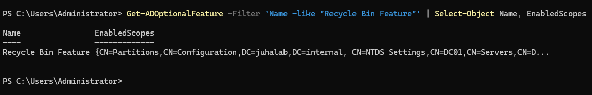
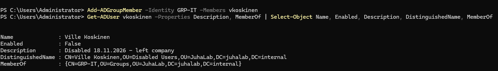
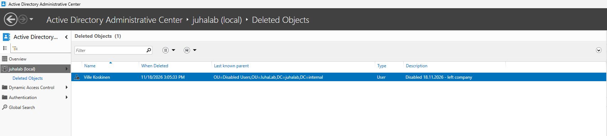
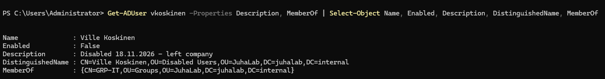

# 12 - AD Recycle Bin: poistetun käyttäjän palautus

Tein 18.11.2026.

**AD Recycle Bin** on Active Directoryn roskakori. Kun objekti, esim. käyttäjä, poistetaan, se ei
katoa heti, vaan siirtyy roskakoriin. Sieltä sen voi palauttaa kaikkine tietoineen: ryhmät, kuvaus,
salasana ja OU.

**Miksi:** "Poistin vahingossa väärän tilin" sattuu oikeasti. Ilman roskakoria tilin voi luoda
uudelleen samalla nimellä, mutta AD:n silmissä se on **eri tili**, jolla on uusi tunniste (SID).
Vanhat kansio-oikeudet eivät silloin toimi, ja ryhmät pitää lisätä käsin uudelleen.

**Tärkeää tietää:** Recycle Bin on oletuksena pois päältä, eikä sitä saa enää pois, kun sen on
kerran laittanut päälle. Siitä ei ole haittaa, ja Microsoft suosittelee sitä, mutta oikeassa
ympäristössä tämä on hyvä tietää.

Työkaluna oli uusi **Active Directory Administrative Center (ADAC)** (Server Manager → Tools).
Sillä hallitaan samoja asioita kuin ADUC:lla, mutta siinä on lisäksi esim. roskakori.

## 1. Lähtötilanne

```powershell
Get-ADOptionalFeature -Filter 'Name -like "Recycle Bin Feature"' | Select-Object Name, EnabledScopes
```

`EnabledScopes` oli tyhjä `{}`, eli roskakori oli pois päältä.

## 2. Käyttöönotto

ADAC → juhalab (local) → Tasks → **Enable Recycle Bin...** → OK (varoitus, ettei toimintoa voi perua)
→ OK (ilmoitus replikoinnista) → F5

Labrassa on vain yksi domain controller, joten replikointia ei tarvinnut odottaa.

Sama komento uudelleen. Nyt EnabledScopes-kentässä näkyivät `CN=Partitions,CN=Configuration,...`
(koko forest) ja `CN=NTDS Settings,CN=DC01,...` (DC01).



## 3. Testi: vkoskisen "vahinkopoisto"

Skenaario: Ville Koskinen lähti firmasta, ja tili suljettiin ([11 - offboarding](11-offboarding.md)).
Joku poistaa tilin vahingossa liian aikaisin, ja sitten huomataan, että sitä vielä tarvitaan.

Lisäsin Villelle testiä varten GRP-IT:n, jotta näkisi, palaako myös ryhmäjäsenyys:

```powershell
Add-ADGroupMember -Identity GRP-IT -Members vkoskinen
Get-ADUser vkoskinen -Properties Description, MemberOf | Select-Object Name, Enabled, Description, DistinguishedName, MemberOf
```



Poisto: ADUC → JuhaLab → Disabled Users → Ville Koskinen → hiiren oikea → **Delete** → Yes

### Roskakorissa

ADAC → juhalab (local) → **Deleted Objects**



**Last known parent** kertoo, missä OU:ssa objekti oli ennen poistoa, ja **When Deleted** kertoo poistoajan.

### Palautus

Ville Koskinen → hiiren oikea → **Restore**. Se palauttaa alkuperäiseen paikkaan.
**Restore To...** antaisi valita toisen OU:n.

### Tarkistus

Sama komento kuin ennen poistoa:



Kaikki palasi ennalleen: `Enabled: False`, kuvaus, Disabled Users -OU ja GRP-IT-jäsenyys.

Lopuksi poistin testiä varten lisätyn GRP-IT:n:

```powershell
Remove-ADGroupMember -Identity GRP-IT -Members vkoskinen -Confirm:$false
```

## Mitä opin

- AD Recycle Bin on oletuksena pois päältä, eikä sitä saa pois, kun sen on kerran laittanut päälle.
- Uudelleen luotu tili ei ole sama tili (uusi SID). Palautettu tili on, ja oikeudet ja ryhmät tulevat mukana.
- ADAC:ssa on ominaisuuksia, joita ADUC:ssa ei ole (kuten Deleted Objects.)
- `Get-ADOptionalFeature` näyttää AD:n lisäominaisuuksien tilan.
