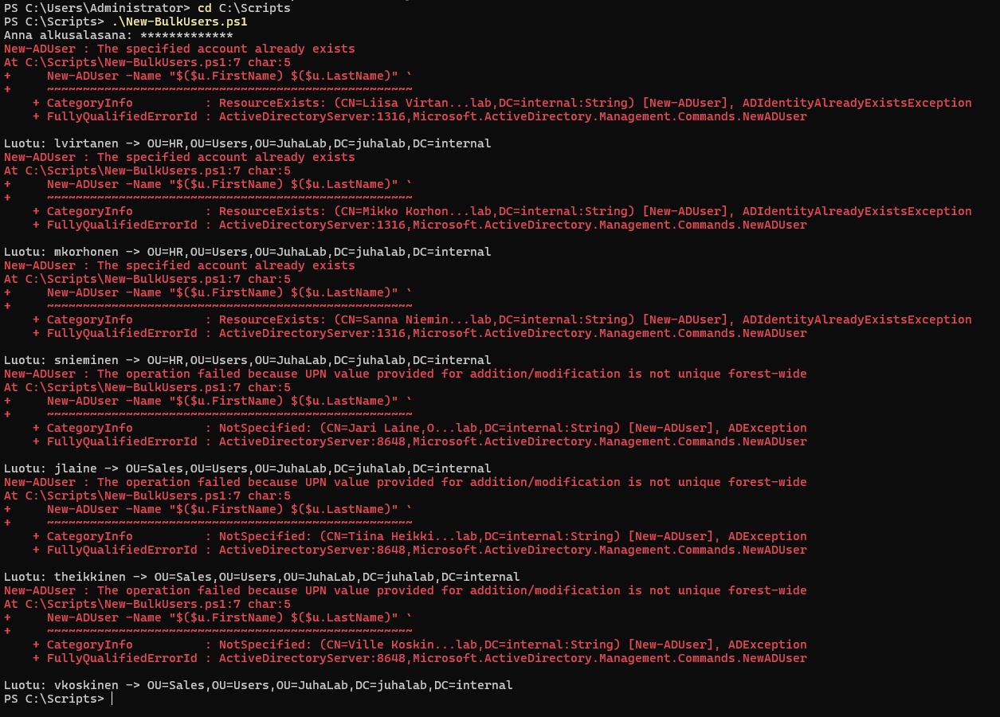
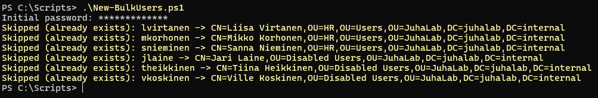
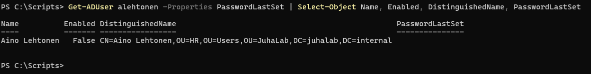
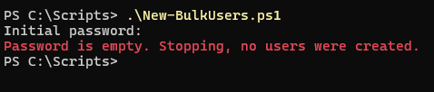
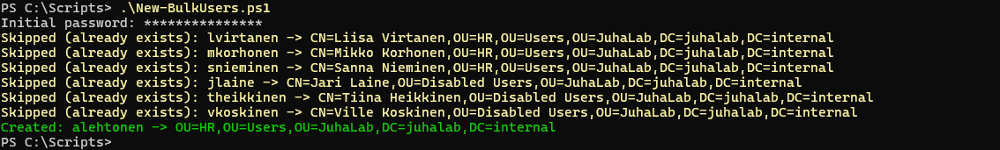

# 13 - Bulk-skriptin parannus: uudelleenajo ja virhetilanteet

Tein 18.11.2026.

[08 - massaluonnin](08-powershell-bulk-users.md) skripti toimi, kun käyttäjiä ei vielä ollut.
Oikeassa työssä CSV:hen lisätään usein uusia rivejä vanhojen perään, esim. kun HR lähettää ensi
kuun uudet työntekijät. Silloin skriptin pitää luoda vain uudet käyttäjät ja ohittaa vanhat siististi.
Skriptin pitää siis **kestää uudelleenajo**.

Testatessa löytyi lisäksi kaksi muuta bugia, ja korjasin nekin.

Skripti: [`scripts/New-BulkUsers.ps1`](../scripts/New-BulkUsers.ps1)

## 1. Lähtötilanne: uudelleenajo

Ajoin vanhan skriptin uudelleen samalla CSV:llä:



Tästä huomasin kolme asiaa:

- **HR-käyttäjät**: *"The specified account already exists"*. Samanniminen käyttäjä oli jo samassa OU:ssa.
- **Sales-käyttäjät**: *"UPN value ... is not unique forest-wide"*. jlaine, theikkinen ja vkoskinen
  ovat nyt Disabled Users -OU:ssa ([11 - offboarding](11-offboarding.md)), joten Sales-OU:ssa nimi oli
  vapaa, mutta kirjautumistunnus (UPN) oli jo käytössä. Tarkistus pitää siis tehdä **koko domainista**,
  muuten lähteneet käyttäjät jäävät huomaamatta.
- **"Luotu: ..."** tulostui jokaisen virheen perään, vaikka mitään ei luotu. Lokin perusteella
  kaikki olisi näyttänyt menneen hyvin.

## 2. Korjaus 1: olemassa olevat ohitetaan

```powershell
$existing = Get-ADUser -Filter "SamAccountName -eq '$($u.SamAccountName)'"
if ($existing) {
    Write-Host "Skipped (already exists): ..." -ForegroundColor Yellow
    continue
}
```

- `-Filter` etsii koko domainista ja palauttaa tyhjän, jos käyttäjää ei löydy. `-Identity`
  antaisi siinä tilanteessa virheen.
- `continue` hyppää suoraan seuraavaan käyttäjään.

Lisäksi New-ADUser on nyt `try`/`catch`-lohkossa ja siinä on `-ErrorAction Stop`, joten
"Created" tulostuu vain, jos luonti oikeasti onnistui. Värit: vihreä = luotu, keltainen = ohitettu,
punainen = epäonnistui.

Tekstit ovat nyt englanniksi, koska Windows PowerShell 5.1 näytti ääkköset väärin (sama ongelma kuin
offboarding-skriptissä).



Sales-käyttäjien polussa näkyy Disabled Users, eli tarkistus löytää heidät muualtakin kuin Sales-OU:sta.

## 3. Testi uudella käyttäjällä, ja bugi 2

Lisäsin CSV:n loppuun uuden työntekijän:

```
Aino,Lehtonen,alehtonen,HR
```

Ensimmäisellä yrityksellä salasana jäi tyhjäksi. Todennäköisesti komennon liittämisen mukana tuli
ylimääräinen Enter, ja `Read-Host` otti sen salasanaksi. Tuloksena tuli *"The password does not meet
the length, complexity, or history requirement"*. Kun ajoin skriptin uudelleen, alehtonen olikin
jo **Skipped (already exists)**.

Syy: `New-ADUser` toimii kahdessa vaiheessa. Se **luo ensin tilin ja asettaa vasta sitten salasanan**.
Kun salasana hylättiin, tili jäi AD:hen puolivalmiina:

```powershell
Get-ADUser alehtonen -Properties PasswordLastSet | Select-Object Name, Enabled, DistinguishedName, PasswordLastSet
```



`Enabled: False` ja `PasswordLastSet` tyhjä: tili on olemassa, mutta salasanaa ei ole koskaan asetettu.
Poistin sen (`Remove-ADUser -Identity alehtonen -Confirm:$false`).

## 4. Korjaus 2: tyhjä salasana ja puolivalmiit tilit

Tyhjä salasana pysäyttää skriptin heti:

```powershell
if ($password.Length -eq 0) {
    Write-Host "Password is empty. Stopping, no users were created." -ForegroundColor Red
    exit
}
```



Jos luonti epäonnistuu muusta syystä, `catch`-lohko poistaa mahdollisen puolivalmiin tilin:

```powershell
$partial = Get-ADUser -Filter "SamAccountName -eq '$($u.SamAccountName)'"
if ($partial) {
    Remove-ADUser -Identity $partial -Confirm:$false
}
```

Tämä on turvallista, koska skripti on jo aiemmin ohittanut kaikki valmiiksi olemassa olleet käyttäjät.
Löytynyt tili on siis varmasti tämän ajon aikana syntynyt.

## 5. Lopullinen testi

Oikealla salasanalla kuusi vanhaa ohitettiin ja vain Aino luotiin:



## Mitä opin

- Skriptin pitää kestää uudelleenajo. Tarkista ensin, tee vasta sitten.
- Tarkistus koko domainista, ei vain kohde-OU:sta, koska käyttäjiä siirtyy OU:sta toiseen.
- Onnistumisviesti vain, kun asia oikeasti onnistui (`try`/`catch` + `-ErrorAction Stop`).
- `New-ADUser` luo tilin ennen salasanaa, joten hylätty salasana jättää puolivalmiin tilin.
- Skriptit kannattaa testata myös virhetilanteissa. Molemmat jälkimmäiset bugit löytyivät vasta, kun jokin meni pieleen.
