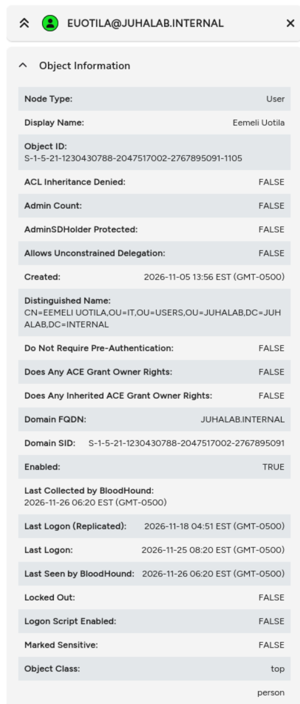
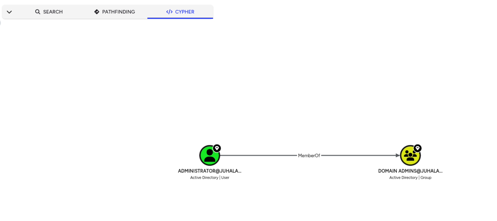
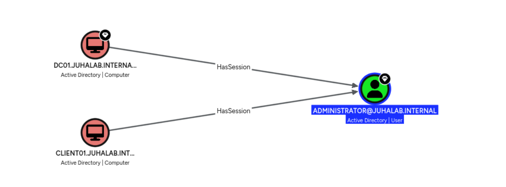

# 15 - Hyökkääjän näkökulma: hyökkäyspolut BloodHoundilla

Tein 25.–26.11.2026.

Edellisessä vaiheessa ([14 - recon ja enumerointi](14-kali-recon-enumeration.md)) sain password
sprayllä yhden toimivan domain-tunnuksen (euotila) ja katsoin, mitä tavallinen käyttäjä näkee.
Nyt vien saman ajatuksen pidemmälle: kun jalansija on olemassa, **mihin siitä pääsee?** Käsin AD:n
oikeuksia ja ryhmäsuhteita on lähes mahdoton hahmottaa, joten käytän työkalua joka tekee sen
puolestani – **BloodHound**.

Kaikki tehdään omassa suljetussa labraverkossa omia koneita vastaan.

## Työkalut

- **BloodHound CE** – työkalu, joka kerää Active Directorysta kaikki suhteet (käyttäjät, ryhmät,
  oikeudet, sessiot) ja piirtää niistä **graafin**. Sen avulla löytää *hyökkäyspolkuja*: esim. että
  jollakin tavallisella käyttäjällä on mutkan kautta reitti Domain Adminiin. Tämä on sama työkalu,
  jota oikeat pentesterit ja red teamit käyttävät. ("CE" = Community Edition, nykyinen ylläpidetty versio.)
- **SharpHound** – BloodHoundin **datankerääjä**. C#-ohjelma, joka kysyy AD:lta tiedot ja paketoi ne
  zip-tiedostoksi, jonka BloodHound osaa lukea.

Työ meni kahdessa osassa: ensin **keruu** (SharpHound), sitten **analyysi** (BloodHound).

## 1. Miksi keruu tehtiin CLIENT01:ltä eikä Kalilta?

Yritin ensin kerätä datan suoraan Kalilta (bloodhound-python ja NetExecin oma BloodHound-moduuli).
Molemmat kaatuivat samaan seinään: DC01:llä on **LDAP signing pakotettu** eikä sillä ole
**LDAPS-sertifikaattia** (`channel binding: No TLS cert`). Linux-kerääjät yrittävät silloin ottaa
salatun LDAPS-yhteyden porttiin 636, joka DC:llä katkeaa kättelyssä:

```
BloodHound collection failed: LDAPSocketOpenError - socket ssl wrapping error: Connection reset by peer
```

Tämä ei ole vika vaan **kovennus**: salaamaton LDAP ei kelpaa, ja LDAPS vaatisi erillisen
varmenteen (AD Certificate Services), jota tässä labrassa ei ole. Kierto on se, jota myös oikeat
testaajat käyttävät: **ajetaan SharpHound suoraan domainiin liitetyltä Windows-koneelta**
(CLIENT01), jolloin Windows hoitaa signing-sinetöinnin natiivisti eikä LDAPS:ia tarvita lainkaan.
Kirjauduin CLIENT01:lle `JUHALAB\Administrator`-tunnuksella (admin-oikeudet tarvittiin seuraavassa
kohdassa Defenderin takia).

## 2. Defender esti SharpHoundin – ja se oli hyvä merkki

Latasin SharpHound CE:n (SpecterOps, GitHub) CLIENT01:lle. Lisäsin ensin kansiolle `C:\Tools`
Defender-poikkeuksen, mutta ajo kaatui silti:

```
Unhandled Exception: System.BadImageFormatException: ... the file contains a virus or potentially
unwanted software. (Exception from HRESULT: 0x800700E1)
```

Syy on opettavainen: SharpHound lataa osan koodistaan **pakattuna suoraan muistiin**, ja Defenderin
**muistinaikainen skannaus (AMSI)** nappasi sen. Kansiopoikkeus kattaa vain levyllä olevat tiedostot,
ei muistissa ajettavaa koodia. Jotta pääsin labrassa eteenpäin, kytkin reaaliaikaisen suojan
hetkeksi pois (ensin Tamper Protection, sitten Real-time protection) – ja **laitoin ne takaisin
päälle heti keruun jälkeen**.

**Opetus puolustajalle:** Defender tuotti tässä oikeaa suojaa. Pelkkä kansiopoikkeus ei riittänyt
hyökkääjälle, koska muistiskannaus tunnisti työkalun silti. Oikeassa hyökkäyksessä tämä tarkoittaa,
että valmiit työkalut eivät mene läpi sellaisenaan – ne pitäisi naamioida tai muokata, mikä nostaa
rimaa ja antaa puolustukselle mahdollisuuden havaita yritys.

## 3. Keruu ja siirto Kalille

Kun suoja oli hetkeksi pois, SharpHound ajettiin:

```powershell
cd C:\Tools\SharpHound
.\SharpHound.exe -c All --outputdirectory C:\Tools\SharpHound
```

Keruu valmistui sekunneissa (`Enumeration finished`, 338 objektia) ja tuotti
`<aikaleima>_BloodHound.zip`.

Siirsin zipin Kalille käyttäen **IT-Sharea** – samaa jaettua kansiota, jonka tein
[vaiheessa 10](10-shared-folder-drive-map.md). Kopioin zipin CLIENT01:ltä jakoon, ja hain sen
Kalille euotilan oikeuksilla (joilla on jakoon READ):

```bash
nxc smb 10.0.2.10 -u euotila -p 'Welcome2026!' --share IT-Share --get-file 20261126125100_BloodHound.zip ./20261126125100_BloodHound.zip
```

## 4. BloodHound CE käyntiin Kalilla

Asensin BloodHound CE:n Kalin omasta pakettivarastosta (natiivi asennus, ei vaadi Dockeria):

```bash
sudo apt install -y bloodhound
sudo bloodhound-setup
sudo bloodhound-start
```

Web-käyttöliittymä nousi osoitteeseen `http://127.0.0.1:8080` (oletustunnus admin/admin, joka
pakotetaan heti vaihtamaan).

**Vastaan tuli muistiongelma:** ensimmäisellä käynnistyksellä palvelu kaatui heti
(`systemctl status bloodhound` näytti `Result: oom-kill`). BloodHound CE pyörittää taustalla sekä
PostgreSQL- että neo4j-tietokantaa, ja Kalin **3 GB RAM ei riittänyt**. Koska analyysiin ei enää
tarvita DC01:tä tai CLIENT01:tä (kaikki data on jo zipissä), sammutin muut VM:t ja **nostin Kalin
muistin 6 GB:iin**. Sen jälkeen palvelu pysyi pystyssä.

Latasin zipin sisään käyttöliittymän **Administration → File Ingest** -kohdasta. Tarkistin että data
tuli perille hakemalla euotilan – kaikki attribuutit näkyivät oikein:



## 5. Löydökset

### Ketkä ovat Domain Admineja?

Ajoin valmiin kyselyn **Find all Domain Admins**:



Ainoa Domain Admin on sisäänrakennettu **Administrator**. Molemmat nodet on merkitty timanttikuvakkeella
= BloodHound pitää niitä **Tier Zero / high value** -kohteina (ympäristön arvokkaimmat tilit). Pieni
ja selkeä tilanne – juuri niin kuin pitää.

### Pääseekö euotila adminiksi?

Merkitsin euotilan **Owned**-tilaan (= jalansija, jonka olen jo murtanut) ja etsin **Pathfinding**-
toiminnolla lyhimmän polun euotilasta Domain Adminsiin. Tulos:

> **Path not found** – euotilalla ei ole hyökkäyspolkua Domain Adminiin.

Tämä on hyvä tulos puolustuksen kannalta: tavallisella käyttäjällä ei ole piilotettua
eskalaatioreittiä ylöspäin. Oikeudet on annettu ryhmien kautta ilman ylimääräisiä delegaatioita,
eikä mikään mutka vie peruskäyttäjästä adminiksi. "Ei polkua" on yhtä arvokas löydös kuin polun
löytäminen – se vahvistaa, että least privilege toimii.

### Missä Domain Admin on kirjautuneena?

Tämä oli kiinnostavin löydös. Katsoin Administrator-tilin **Sessions**-tiedot eli millä koneilla se
on kirjautuneena:



Domain Admin on kirjautuneena **sekä DC01:lle että CLIENT01:lle** (`HasSession`-reunat). Työaseman
(CLIENT01) sessio on riski, ja tässä on miksi:

1. Hyökkääjällä on euotilan creds – tavallinen käyttäjä, ei suoraa reittiä adminiksi (näimme: ei polkua)
2. BloodHound paljastaa, että **Domain Admin on kirjautuneena työasemalle**
3. Jos hyökkääjä saa paikallisen adminin CLIENT01:llä (jonkin toisen heikkouden kautta), hän voi
   lukea koneen muistista (LSASS) siellä olevan Administratorin tunnukset tai Kerberos-tiketin
4. → varastettu Domain Admin → **koko domain on menetetty**

Juuri tällaisia epäsuoria oikoteitä BloodHound on tehty löytämään. Luin tämän heikkouden itse
asiassa itse, kun kirjauduin Administratorina CLIENT01:lle ajaakseni SharpHoundin – mikä on
realistinen esimerkki siitä, miten Domain Admin -sessio päätyy työasemalle oikeassakin ympäristössä.

**Korjaus (tieraus, Tier 0):** Domain Admin -tilejä ei saa koskaan käyttää työasemilla tai
tavallisilla palvelimilla. Niillä kirjaudutaan vain domain controllereille / Tier 0 -järjestelmiin,
ideaalisti erillisiltä hallintakoneilta (PAW = Privileged Access Workstation). Päivittäiseen
työhön käytetään erillistä, oikeuksiltaan rajattua tiliä.

## Mitä tämä tarkoittaa puolustajalle

| Havainto | Puolustus labrassa |
|---|---|
| LDAP signing pakotettu, ei anonyymiä LDAPS:ia → Linux-kerääjät estyivät | DC:n kovennus toimii; keruu vaati pääsyn domain-koneelle |
| Defender nappasi SharpHoundin **muistista** (AMSI), vaikka kansio oli poikkeuksena | Reaaliaikainen suoja tuo oikeaa arvoa – valmiit työkalut eivät mene läpi sellaisenaan |
| Vain yksi Domain Admin (Administrator), merkitty Tier Zeroksi | Admin-tilejä mahdollisimman vähän |
| euotilalla **ei polkua** Domain Adminiin | Least privilege ja siistit delegaatiot; oikeudet ryhmien kautta |
| Domain Admin kirjautuneena **työasemalle** (CLIENT01) | **Korjattava:** Tier 0 -tilit vain DC:ille / PAW:lle, ei työasemille |

## Mitä opin

- BloodHound näyttää AD:n *suhteina ja polkuina*, ei pelkkänä listana. Se löytää oikoteitä, joita
  käsin ei huomaisi.
- Kerääjän valinta riippuu ympäristöstä: kun DC pakottaa LDAP signingin eikä LDAPS:ia ole, Linux-
  kerääjät eivät toimi ja data haetaan domain-koneelta SharpHoundilla. Este oli itse asiassa merkki
  oikeasta kovennuksesta.
- Defenderin muistiskannaus (AMSI) estää valmiit hakkerointityökalut, vaikka tiedostolle tekisi
  levypoikkeuksen. Puolustus tuo oikeaa arvoa.
- "Ei hyökkäyspolkua" on yhtä tärkeä löydös kuin polun löytäminen – se todistaa, että least
  privilege on kunnossa.
- Domain Admin -sessio työasemalla on vakava riski: se muuttaa yhden koneen murron koko domainin
  menetykseksi. Siksi arvokkaat tilit kuuluvat vain Tier 0 -koneille.
