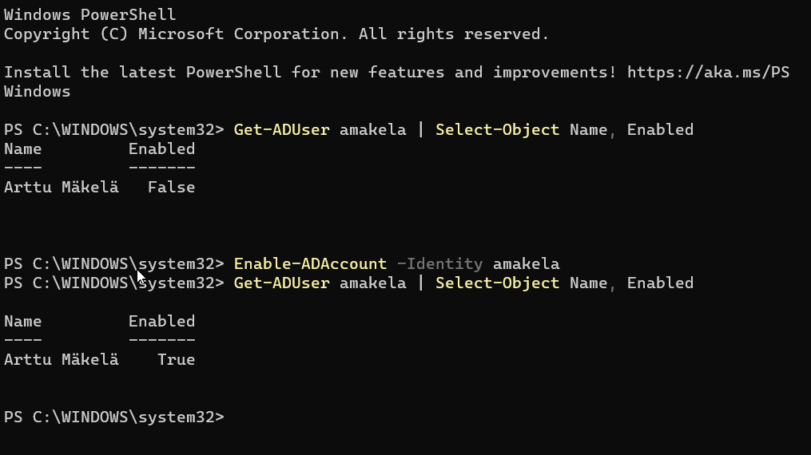
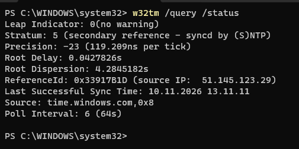

# Troubleshooting

Tähän kirjaan asiat, jotka menivät pieleen, ja miten ne korjattiin.

---

## 4.11.2026: GitHubiin lähettäminen ei onnistunut

**Mitä tapahtui:** Yritin lähettää repon GitHubiin komennolla `git push`, mutta sain virheen
"Internal Server Error".

**Miksi:** Vika ei ollut omassa päässä, vaan GitHubissa. 
Sen näki sivulta githubstatus.com. `git push` myöähemmäksi.

**Miten korjasin:** Odotin, että GitHub sai vian korjattua ja yritin sitten uudelleen.
Työt olivat koko ajan tallessa omalla koneellani.

**Mitä opin:** Kun virheessä lukee "Internal Server Error" (eli virhe 500), ongelma on
palvelimen päässä. Tsekkaus tilasivuun ennen kuin alkaa korjata omia asetuksia.

---

## 4.11.2026: Palvelin-VM jäi mustalle ruudulle

**Mitä tapahtui:** Käynnistin DC01-virtuaalikoneen, mutta ruutu pysyi mustana.
Mitään ei tapahtunut, ei edes asennuksen aloitusta.

**Miksi:** Koneessani on päällä Windowsin oma tietoturvaominaisuus (Memory Integrity),
joka käyttää samaa virtualisointia kuin VirtualBox. Siksi VirtualBox joutuu toimimaan
"Windowsin kautta", ja se teki virtuaalikoneen käynnistyksestä epävakaan. Käynnistys jäi
jumiin kohtaan, jossa se yritti ottaa käyttöön useamman prosessoriytimen.

**Korjaus:** Vaihdoin VM:n asetuksista prosessorien määrän kahdesta yhteen. Sen jälkeen VM käynnistyi ja asennus lähti käyntiin.

**Mitä opin:** Jokaisella VM:llä on oma lokitiedosto (VirtualBox VMs\DC01\Logs\VBox.log),
josta näkee, mihin kohtaan käynnistys jäi. Sieltä vian syy löytyi.

---

## 5.11.2026: Windows 11 ei suostunut asentumaan, ja oikea korjaus mustaan ruutuun

**Mitä tapahtui:** CLIENT01:n asennus pysähtyi ilmoitukseen "The processor needs to have
two or more cores". Windows 11 vaatii vähintään kaksi prosessoria, mutta kahdella prosessorilla
VM jäi samalle mustalle ruudulle kuin DC01. Edellinen kikka (yksi prosessori) ei siis enää käynyt.

**Miksi:** Prosessorin virtualisointiominaisuutta (VT-x) voi käyttää vain yksi ohjelma kerrallaan.
Koneellani Windows piti sitä varattuna kolmelle omalle jutulleen, joten VirtualBox joutui
kulkemaan Windowsin kautta. Siitä tuli ongelmia.

**Miten korjasin:** Kytkin pois päältä kolme asiaa ja käynnistin koneen uudelleen:

1. **Memory Integrity** (Windows-suojaus → Laitteen suojaus → Ydinkulun eristys)
2. **Hypervisorin käynnistys:** `bcdedit /set hypervisorlaunchtype off` (admin-PowerShell)
3. **VBS** ja **Virtual Machine Platform:**
   ```powershell
   reg add "HKLM\SYSTEM\CurrentControlSet\Control\DeviceGuard" /v EnableVirtualizationBasedSecurity /t REG_DWORD /d 0 /f
   Disable-WindowsOptionalFeature -Online -FeatureName VirtualMachinePlatform -NoRestart
   ```

Ensimmäinen yritys (kohdat 1 ja 2) ei riittänyt, koska hypervisori käynnistyi silti. Tarkistuksessa
selvisi, että VBS oli yhä päällä rekisterissä. Kun kytkin senkin ja Virtual Machine Platformin pois,
homma toimi. Nyt VBox-lokissa lukee "VT-x", eikä enää "fall back to NEM", ja VM:t käynnistyvät
kahdella prosessorilla ja paljon nopeammin.

**Mitä se maksoi:** Koneestani puuttuu nyt yksi tietoturvakerros (ytimen eristys). Defender,
palomuuri ja päivitykset toimivat normaalisti. Hyväksyin tämän labrakäytön takia.

**Miten perun muutokset, kun labra on valmis** (admin-PowerShell + uudelleenkäynnistys):
```powershell
bcdedit /set hypervisorlaunchtype auto
reg add "HKLM\SYSTEM\CurrentControlSet\Control\DeviceGuard" /v EnableVirtualizationBasedSecurity /t REG_DWORD /d 1 /f
Enable-WindowsOptionalFeature -Online -FeatureName VirtualMachinePlatform
```
Lisäksi Memory Integrity takaisin päälle Windows-suojauksesta.

**Mitä opin:** Jos korjaus ei toimi, kannattaa tarkistaa, mikä oikeasti on päällä, eikä vain olettaa.
Lisäksi ensimmäinen "kikka" (yksi prosessori) kiersi ongelman, mutta ei korjannut sitä.

---

## 10.11.2026: Unohdin testikäyttäjän salasanan

**Mitä tapahtui:** Yritin kirjautua CLIENT01:lle käyttäjällä `JUHALAB\euotila`, mutta en
muistanut enää Eemelin salasanaa, jonka annoin käyttäjää luodessa.

**Miksi:** Ihan vaan unohdin sen. Salasanaa ei voi katsoa mistään, edes adminina, koska AD
ei tallenna salasanoja selväkielisinä.

**Miten korjasin:** Nollasin salasanan DC01:llä:

1. Active Directory Users and Computers → JuhaLab → Users → IT
2. Eemeli Uotila → oikea klikkaus → **Reset Password...**
3. Uusi salasana kahteen kertaan ja OK

Sen jälkeen kirjautuminen CLIENT01:lle onnistui uudella salasanalla.

**Mitä opin:** Salasanan nollaus on yksi helpdeskin yleisimmistä tehtävistä. Oikeassa työssä
valitaan aina "User must change password at next logon", jotta vain käyttäjä itse tietää
salasanansa. Jos tili lukittuu liian monesta väärästä yrityksestä, saman ikkunan
"Unlock the user's account" -valinnalla tilin saa auki.

---

## 10.11.2026: Testikäyttäjän tili oli poistettu käytöstä

**Mitä tapahtui:** Testasin tilin lukitusta kirjautumalla CLIENT01:lle käyttäjällä
`JUHALAB\amakela` väärällä salasanalla. Jo ensimmäisellä yrityksellä tuli ilmoitus
"Your account has been disabled. Please see your system administrator".

**Miksi:** Artun tili oli disabled-tilassa. Todennäköisesti "Account is disabled" -ruksi jäi
päälle, kun loin käyttäjän. Disabled ja locked ovat eri asioita:

- **Locked** = tili lukittuu itsestään liian monen väärän salasanan jälkeen ja aukeaa ajan kanssa
  tai adminin toimesta
- **Disabled** = admin on ottanut tilin pois käytöstä, eikä se aukea itsestään

**Miten korjasin:** Tarkistin tilan DC01:llä PowerShellillä ja otin tilin käyttöön:

```powershell
Get-ADUser amakela | Select-Object Name, Enabled   # Enabled : False
Enable-ADAccount -Identity amakela
Get-ADUser amakela | Select-Object Name, Enabled   # Enabled : True
```



Graafisesti sama onnistuu ADUC:ssa: käyttäjä → oikea klikkaus → Enable Account.
Disabled-tilin tunnistaa ADUC:ssa kuvakkeen pienestä alaspäin osoittavasta nuolesta.

**Mitä opin:** Virheilmoitus kannattaa lukea tarkkaan, koska "disabled" ja "locked" vaativat eri
korjauksen. Oikeassa työssä disabled-tiliä ei kannata ottaa heti käyttöön, vaan ensin selvitetään,
miksi se on suljettu (esim. työsuhde päättynyt tai tili kaapattu).

---

## 10.11.2026: DC01:n kello oli 4,5 päivää jäljessä

**Mitä tapahtui:** Testasin tilin lukitusta ja etsin Event Viewerista lukitustapahtumaa (Event ID 4740).
Lokissa näkyi vain yksi tapahtuma, ja sen päiväys oli 5.11.2026 klo 23.57, vaikka testasin 10.11.

**Miksi:** `Get-Date` DC01:llä näytti "perjantai 6. marraskuuta 2026 0.30". Olin laittanut DC01:n
5.11. illalla Save state -tilaan. Kun palautin sen, kello jatkoi siitä, mihin se oli jäänyt.
VM:ssä ei ollut VirtualBox Guest Additionsia, joten kello ei synkronoitunut hostin kanssa.
Lokin tapahtuma oli siis tämänpäiväinen testi, mutta väärällä kellonajalla.

**Miten korjasin:**

1. Asensin DC01:lle Guest Additionsin: Devices → Insert Guest Additions CD image →
   VBoxWindowsAdditions.exe → Reboot. Uudelleenkäynnistyksen jälkeen kello oli oikein.
   (Samalla sain jaetun leikepöydän päälle: Devices → Shared Clipboard → Bidirectional.)
2. Asetin DC01:n hakemaan ajan netistä, koska se on koko domainin aikalähde:

```powershell
w32tm /config /manualpeerlist:"time.windows.com,0x8" /syncfromflags:manual /reliable:yes /update
Restart-Service w32time
w32tm /resync /force
w32tm /query /status   # Source: time.windows.com,0x8
```



**Mitä opin:** AD:ssa kello on tärkeä. Kerberos-kirjautuminen toimii vain, jos koneiden kellot ovat
korkeintaan 5 minuutin päässä toisistaan. Väärä kello sotkee myös lokit, koska tapahtumat näyttävät
tapahtuneen eri aikaan kuin oikeasti. Domainissa koneet hakevat ajan DC:ltä, joten DC:n pitää
hakea se luotettavasta lähteestä. Jos ero on yli 48 tuntia, DC:n aikapalvelu ei korjaa sitä itse,
vaan kello pitää ensin asettaa käsin (`Set-Date`).
